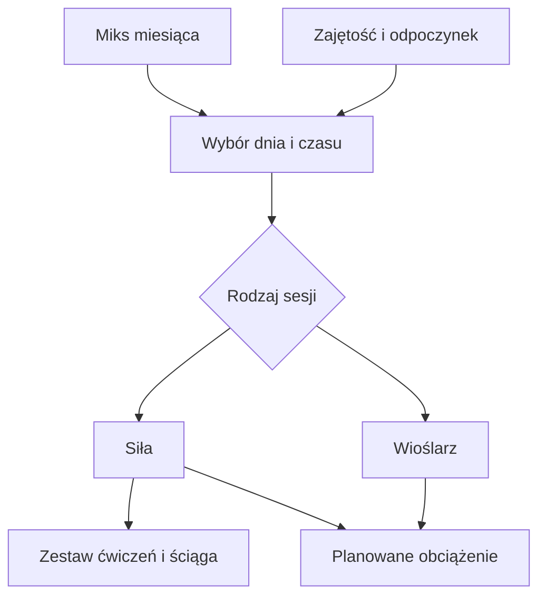
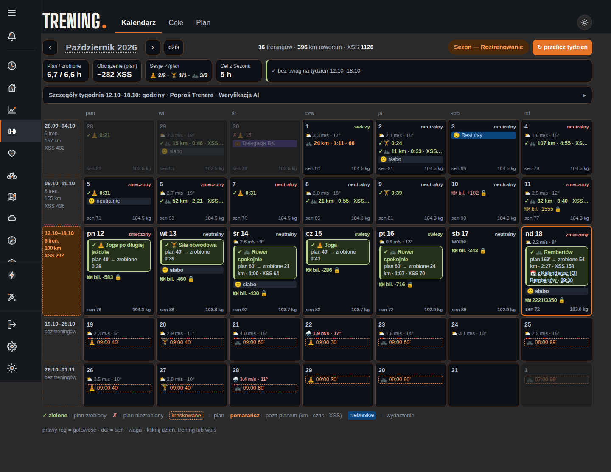

# Siła i wioślarz

Silnik może włączyć do tygodnia siłę obwodową i trening na wioślarzu. Planowany wysiłek pokazuje [XSS](../slowniczek.md#xss) (punkty obciążenia treningu). Liczba tych sesji zależy od miksu danego miesiąca oraz ograniczeń kalendarza. Planowane obciążenie opisuje [XSS](../slowniczek.md#xss) (punkty obciążenia treningu). Szczegóły zaplanowanej siły mogą pochodzić z katalogu ćwiczeń i być pokazane w ściądze.

## Jak liczone

Domyślny miks liczby sesji na miesiące jest osobny dla każdego sportu. W obecnym silniku rower ma 3–5 sesji tygodniowo zależnie od miesiąca, siła 1–3, a wioślarz 0–2. To wartości miksu, a nie obietnica, że każda sesja zawsze znajdzie się w danym tygodniu. Konflikty kalendarza i pozostałe reguły mogą zmienić plan.

Domyślne obciążenie planu to 0,3 XSS/min dla siły oraz 0,6 XSS/min dla wioślarza. Przykład z bazy: 13.10.2026 sesja siłowa trwała 39 minut i miała 12 planowanych [XSS](../slowniczek.md#xss) (punktów opisujących obciążenie treningu).

Policz przykład planu ręcznie: 40 min × 0,3 = 12 XSS. Baza pokazuje 40 minut planu i 39 minut wykonania 13.10.2026. Nie wyliczaj XSS wykonania jako 39 × 0,3, bo jest to stawka planu, nie potwierdzony sposób oceny wykonanego treningu.

## Jak czytać obciążenie

1. Odczytaj sport i czas planu. Dla siły 13.10.2026 zapisany plan miał 40 min.
2. Pomnóż czas przez stawkę planu: 40 × 0,3 = 12 XSS.
3. Odczytaj wykonanie osobno: baza pokazuje 39 min. Nie zmieniaj przez to wstecz planowanych 12 punktów.
4. Dla wioślarza kod przyjmuje 0,6 XSS/min; nie mam w tym odczycie przykładu wykonanego treningu wioślarskiego, więc nie podaję wyniku z użytkowej sesji.

Jeśli w tygodniu nie ma siły, sprawdź wolne okna oraz bliskość długiej jazdy lub wyprawy. Miks określa miesięczną liczbę docelową, a dostępność i odpoczynek nadal ograniczają konkretne dni.

Rower, siła i wioślarz nie są wymienne w planie. Każdy z nich ma osobną liczbę sesji zależną od miesiąca. Wartości miksu nie oznaczają, że Trener zawsze umieści taką liczbę treningów: zajętość, przerwa po mocnym wysiłku i minimalne dni odpoczynku mogą ograniczyć wynik. Joga w tym układzie ma własne zastosowania regeneracyjne i nie dodaje planowanego XSS.

## Ograniczenia i pułapki

Ćwiczenia siłowe są osobnym zagadnieniem od samej liczby sesji. Baza ćwiczeń i zapisany zestaw mogą mieć własne ograniczenia, np. dostępność grafik. Szczegóły wyboru zestawu wskazano w źródłach na dole hasła.

Jeżeli w tygodniu nie ma wioślarza albo siły, sprawdź miesiąc, wolne dni i ostatnie ciężkie treningi. Miesięczny miks jest celem dla rozkładu, a nie nakazem wstawienia sesji w zajęty dzień. Opis doboru zestawu i ściągi znajduje się w [Ćwiczeniach siłowych](cwiczenia-sciaga.md).

## Wpływa na

- Miks sportów i obciążenie tygodnia.

## Zależy od

- Fazy sezonu, miksu miesiąca, dostępności oraz reguł regeneracji.

## Powiązane hasła

- [Plan tygodnia](plan-tygodnia.md)
- [XSS](xss.md)
- [Kalendarz](kalendarz.md)

## Zrodla

- `qbot_trener_engine.py` — `MIXD`, `XSS_PER_MIN`, `plan_week`.
- `qbot_trener_sila.py` — wybór ćwiczeń i zestawu siłowego.
- `qbot_trener_workouts.py` — starszy generator treningów.
- `/opt/qbot/web/public/trener.js` — karta treningu i link do ściągi.
- `qbot_v2.trainer_session` — przykład z 13.10.2026.
