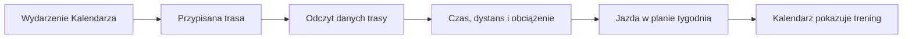

# Trasy jako trening

Wydarzenie w Kalendarzu z przypisaną trasą może zostać potraktowane przez Trenera jako planowana jazda. Dzięki temu trasa wchodzi do tygodniowego obciążenia i nie jest liczona drugi raz jako zwykłe wydarzenie obok treningu.

## Jak liczone

Silnik odczytuje wydarzenia z `calendar_entry` i przypisania z `calendar_day_route`. Dla trasy szuka danych bazowych, a gdy ich nie ma, może oszacować czas i obciążenie na podstawie podobnych jazd z historii. W wydarzeniu wielodniowym jedna trasa jest rozdzielana na dni. Wydarzenie rozpoznane jako jazda z trasą jest wyłączane z osobnej listy zwykłych wpisów, aby uniknąć podwójnego kafelka.

Zakładka celów pozwala wybrać policzoną trasę. Interfejs pobiera jej podsumowanie i wypełnia dane celu; użytkownik może je później poprawić.

Przykład z ekranu 18.10.2026: „Rembertów” ma plan 163 min, około 54 km i 158 [XSS](../slowniczek.md#xss) (punktów obciążenia); wykonanie ma 147 min, około 53 km i 157,7 XSS. Kalendarz pokazuje trasę w komórce niedzieli, a nie jako drugie wydarzenie obok jazdy. Odczyt bazy potwierdza 163 min planu i 156 planowanych XSS; zrzut przedstawia zaokrąglone dane i nie wszystkie pola muszą być identycznie zaokrąglone.

Na widoku 18.10.2026 kafelek zawiera 163 minuty, około 54 km i zaokrąglone 158 punktów planu. Odczyt sesji pokazuje 156 planowanych punktów i wykonanie około 157,7. Różnica między 158 na ekranie a 156 w bazie nie została wyjaśniona; nie wyliczam z niej brakującej reguły.

> DO SPRAWDZENIA: dlaczego zrzut dla 18.10 pokazuje 158 planowanych punktów, a odczyt sesji z bazy 156.

Jeśli trasa trwa kilka dni, silnik rozdziela ją na dni i może włączyć do planu tylko część dystansu z danego dnia. Sprawdź daty wydarzenia i przypisanie trasy, zanim porównasz jej sumę z pojedynczym treningiem.

## Ograniczenia i pułapki

Jeżeli dane trasy nie pozwalają ustalić czasu albo obciążenia, silnik korzysta z podobnych jazd lub wartości domyślnych dla danego rodzaju sesji. Dokładny wynik zależy więc od dostępnych danych bazowych i historii.

Gdy trasa została dodana ręcznie, sprawdź, czy jest przypięta do wydarzenia dnia. Sama nazwa w notatce nie dowodzi, że planer wykorzystuje długość śladu. Jeżeli liczby w raporcie trasy różnią się od Kalendarza, sprawdź datę aktualizacji i to, czy oglądasz plan, czy wykonanie.

## Wpływa na

- Planowany czas, dystans i XSS tygodnia oraz rozpoznanie długiej jazdy.

## Zależy od

- Wpisu Kalendarza, przypięcia trasy i danych trasy/historii aktywności.

## Powiązane hasła

- [Kalendarz](kalendarz.md)
- [Plan tygodnia](plan-tygodnia.md)
- [XSS](xss.md)
- [Planer wyprawy](../trasy/planer-wyprawy.md)

## Zrodla

- `qbot_trener_engine.py` — `build_context`, `_route_days`, `route_rides`.
- `/opt/qbot/web/public/kalendarz3.js` — `inPlan`, `gridEnts`, `planEnts`.
- `/opt/qbot/web/public/trener.js` — `routeSel`, pobieranie `/route_summary`.
- `qbot_v2.calendar_entry`, `qbot_v2.calendar_day_route`, `qbot_v2.route_base`.
