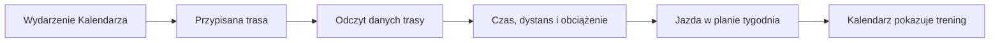

# Trasy jako trening

Wydarzenie w Kalendarzu z przypisaną trasą może zostać potraktowane przez Trenera jako planowana jazda. Dzięki temu trasa wchodzi do tygodniowego obciążenia i nie jest liczona drugi raz jako zwykłe wydarzenie obok treningu.

## Jak liczone

Silnik odczytuje wydarzenia z `calendar_entry` i przypisania z `calendar_day_route`. Dla trasy szuka danych bazowych, a gdy ich nie ma, może oszacować czas i obciążenie na podstawie podobnych jazd z historii. W wydarzeniu wielodniowym jedna trasa jest rozdzielana na dni. Wydarzenie rozpoznane jako jazda z trasą jest wyłączane z osobnej listy zwykłych wpisów, aby uniknąć podwójnego kafelka.

Zakładka celów pozwala wybrać policzoną trasę. Interfejs pobiera jej podsumowanie i wypełnia dane celu; użytkownik może je później poprawić.

Przykład z ekranu i bazy 18.10.2026: „Rembertów” ma plan 163 min i 156 XSS; wykonanie ma 147 min i 157,699996948242 XSS. W komórce Kalendarza zielony znak ✓ i liczba 158 opisują wykonanie, nie plan. Kod zaokrągla rzeczywiste 157,6999… do 158. Liczba planu 156 jest pokazywana osobno w nawiasie „plan” w szczegółach.

Ręczne sprawdzenie: 157,699996948242 zaokrąglone do pełnego punktu daje 158. Pozostawienie bez zaokrąglenia pokazuje różnicę między wykonaniem a planem: 157,699996948242 − 156 = 1,699996948242 XSS. Nie jest to rozbieżność danych; podpis na zrzucie został wcześniej błędnie odczytany jako plan.

Jeśli trasa trwa kilka dni, silnik rozdziela ją na dni i może włączyć do planu tylko część dystansu z danego dnia. Sprawdź daty wydarzenia i przypisanie trasy, zanim porównasz jej sumę z pojedynczym treningiem.

## Ograniczenia i pułapki

Jeżeli dane trasy nie pozwalają ustalić czasu albo obciążenia, silnik korzysta z podobnych jazd lub wartości domyślnych dla danego rodzaju sesji. Dokładny wynik zależy więc od dostępnych danych bazowych i historii.

Gdy trasa została dodana ręcznie, sprawdź, czy jest przypięta do wydarzenia dnia. Sama nazwa w notatce nie dowodzi, że planer wykorzystuje długość śladu. Jeżeli liczby w raporcie trasy różnią się od Kalendarza, sprawdź datę aktualizacji i to, czy oglądasz plan, czy wykonanie.

## Wpływa na

- Planowany czas, dystans i XSS tygodnia oraz rozpoznanie długiej jazdy.

## Zależy od

- Wpisu Kalendarza, przypięcia trasy i danych trasy/historii aktywności.

## Powiązane hasła

- [Kalendarz](kalendarz.md)
- [Plan tygodnia](plan-tygodnia.md)
- [XSS](xss.md)
- [Planer wyprawy](../trasy/planer-wyprawy.md)

## Zrodla

- `qbot_trener_engine.py` — `build_context`, `_route_days`, `route_rides`.
- `/opt/qbot/web/public/kalendarz3.js` — `inPlan`, `gridEnts`, `planEnts`.
- `/opt/qbot/web/public/trener.js` — `routeSel`, pobieranie `/route_summary`.
- `qbot_v2.calendar_entry`, `qbot_v2.calendar_day_route`, `qbot_v2.route_base`.
