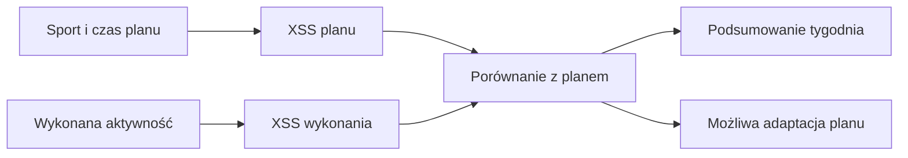
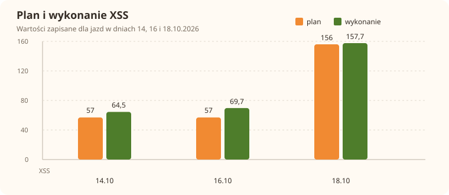

# XSS w Trenerze

[XSS](../slowniczek.md#xss) to punkty opisujące obciążenie treningowe. W tygodniowym podsumowaniu widzisz sumę obciążenia planu; przy wykonanej sesji system może zapisać osobną wartość rzeczywistą. XSS pomaga porównywać treningi, ale nie jest czasem ani oceną jakości treningu.

## Jak liczone

Domyślny plan używa różnych stawek na minutę: rower zależnie od strefy, siła 0,3 XSS/min, wioślarz 0,6 XSS/min, joga 0. Wykonana jazda może otrzymać XSS z ModelQ. Kod oznacza różnicę względem planu jako „więcej/mniej” przy różnicy co najmniej 10% czasu lub obciążenia. Reakcja adaptacyjna korzysta z progu `adapt.xss_delta`, domyślnie 15 punktów.

Przykład z bazy: 11.10.2026 planowane 236 XSS, wykonane 244,9 XSS. Różnica wyniosła 8,9 XSS, czyli około 3,8% planu. Wartości nie przekroczyły domyślnego progu 15 punktów.

Przykład z wybranego tygodnia: 14.10.2026 plan 57, wykonanie 64,5, różnica 7,5 XSS. 16.10 plan 57, wykonanie około 69,7, różnica około 12,7 XSS. 18.10 plan 156, wykonanie około 157,7, różnica około 1,7 XSS. Na kartce odejmij plan od wykonania; nie dodawaj tych różnic do czasu treningu. W zrzucie widać również sumę tygodnia 282 XSS planu i 6,7 h planu wobec 6,6 h wykonania.

Wzór

XSS planu dla prostego treningu to liczba minut pomnożona przez stawkę danego sportu i strefy. Przykład z zapisanym treningiem siłowym 13.10.2026: 40 min planu × 0,3 XSS/min = 12 XSS. Dla jazdy stawka bazowa zależy od strefy i może być dodatkowo skalibrowana. Wykonane XSS pochodzi z danych aktywności/modelu, więc nie należy odtwarzać go tym prostym wzorem.

## Ręczne porównanie z tygodnia

1. 14.10.2026: wykonane 64,5 minus plan 57 daje 7,5 XSS.
2. 16.10.2026: około 69,7 minus 57 daje około 12,7 XSS.
3. 18.10.2026: około 157,7 minus plan 156 daje około 1,7 XSS.
4. Wszystkie trzy różnice są mniejsze od domyślnej adaptacyjnej granicy 15 punktów. Etykieta większego/mniejszego odchylenia używa odrębnej granicy 10% czasu lub obciążenia.

Wykres pod hasłem pokazuje te same wartości. Słupki są XSS, nie minutami. W widoku miesiąca może pojawić się też suma tygodnia; nie dodawaj jej ponownie do sum dziennych.

## Ograniczenia i pułapki

Po dopasowaniu wykonania system zachowuje oddzielnie wartość planowaną i rzeczywistą. Widok tygodnia może równocześnie pokazywać sumę planu oraz osobne godziny wykonania.

Nie należy porównywać godzin z punktami obciążenia ani zakładać, że wszystkie rodzaje sportu liczą się identycznie. Przerywany kontur na ekranie oznacza plan, zielony znacznik — wykonanie. W szczegółach sprawdź, czy liczba należy do planu czy jazdy.

## Wpływa na

- Suma obciążenia tygodnia, przerwa po ciężkiej jeździe i adaptacja planu do wykonania.

## Zależy od

- Sportu, planowanego czasu i strefy albo danych rzeczywistej aktywności.

## Powiązane hasła

- [Plan tygodnia](plan-tygodnia.md)
- [Siła i wioślarz](sila-wioslarz.md)
- [XSS w ModelQ](../modelq/xss.md)

## Zrodla

- `qbot_trener_engine.py` — `XSS_PER_MIN`, obsługa `real_xss`, `deviation`.
- `qbot_trener_ops.py` — `refresh_real`.
- `/opt/qbot/web/public/trener.js` — podsumowanie XSS tygodnia.
- `qbot_v2.trainer_session` — przykład z 11.10.2026.
