# Mapa wpływów i zależności QBota

## Co to jest

Mapa pokazuje sprawdzone połączenia między danymi i funkcjami QBota. Strzałka oznacza, że kod przekazuje wynik dalej albo czyta wspólną tabelę; nie oznacza, że każda część odświeża się w tej samej chwili.

## Po co

Pomaga zrozumieć, skąd bierze się wynik i co może przestać działać, gdy zabraknie danych wejściowych.

## Albert i kanały rozmowy

| Wejście | Pośrednik | Odbiorca | Skutek |
|---|---|---|---|
| Pytanie przez MCP | `qbot3/adapters/mcp_adapter.py` | `qbot_query_handler` albo `qbot3.agent_runtime.orchestrate_query` | Odpowiedź z routera lub Alberta; dopuszczone zapisy mogą zostać wykonane po stronie serwera |
| Zwykły tekst Telegrama | webhook `qbot_api.py` | `qbot_qcal_telegram.handle_message` | Odpowiedź tekstowa w Telegramie |
| Komenda Telegrama | webhook `qbot_api.py` | obsługa komendy; część komend wywołuje `_tool_qbot_query` | Skrócony status, pomoc albo wynik zapytania |

Zwykły tekst Telegrama i `qbot_query` nie mają potwierdzonej wspólnej ścieżki. Dokument transparentnego interfejsu Telegrama opisuje cel migracji, a nie pełny stan bieżącego kodu.

## Skąd dane

Głównym źródłem szczegółów jazdy jest `qbot_v2.activity_record`. Wyniki dzienne i treningowe są przechowywane w `qbot_v2.modelq2_ride`, `qbot_v2.fitmodel_daily` i tabelach `qbot_v2.trainer_*`. Garaż używa osobnej bazy SQLite `data/garage.db`. Trasy korzystają z własnych tabel i usług mapowych oraz pogodowych.

## Jak liczone

### Całość w skrócie

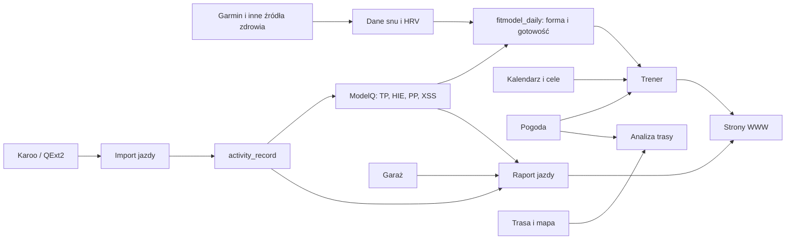

### Jazda i ModelQ

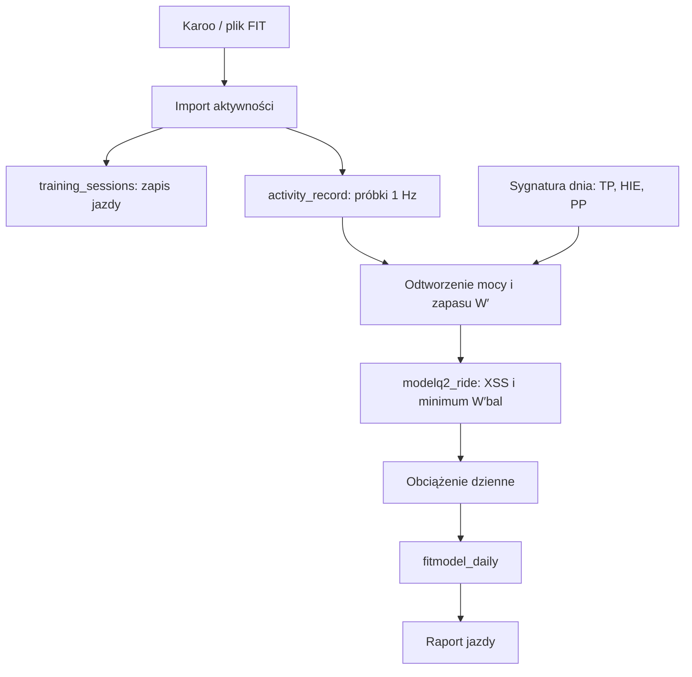

Import przechowuje podsumowanie jazdy w `training_sessions`, a próbki sekundowe w `activity_record`. `fitmodel.modelq2.publish` tworzy w `modelq2_ride` wynik dla jazdy, a następnie publikuje sygnaturę i obciążenia do `fitmodel_daily`. XSS jest dzielone na Low, High i Peak; jego składowe służą do opisu obciążenia wysiłkiem tlenowym, ponadprogowym i sprinterskim.

Szczegóły: [TP](modelq/tp.md), [HIE](modelq/hie.md), [PP](modelq/pp.md), [LTP](modelq/ltp.md), [W′bal](modelq/wprime-bal.md) i [XSS](modelq/xss.md). Kolumna `cp_modelq_w` jest publikowana jako TP, a `wprime_modelq_kj` jako HIE. Xert trafia do osobnej tabeli porównawczej i nie jest wejściem bieżącej sygnatury.

### ModelQ — szczegółowa droga danych

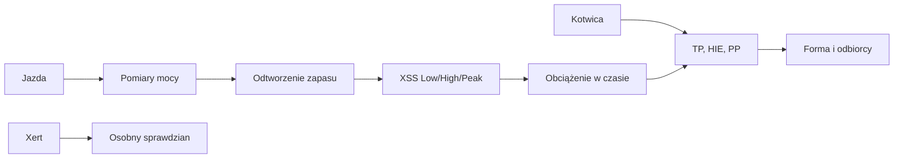

| Element | Zależy od | Wpływa na | Szczegóły |
|---|---|---|---|
| TP | najbliższej kotwicy i długiego obciążenia z opóźnieniem | W′bal, XSS, odbiorcy progu | [TP](modelq/tp.md) |
| HIE | kotwicy i obciążenia High | zapas w jeździe, LTP i XSS | [HIE](modelq/hie.md) |
| PP | kotwicy i zmiany HIE | górny zakres krzywej i podział Peak | [PP](modelq/pp.md) |
| XSS jazdy | próbki mocy i sygnatura sprzed jazdy | długie/krótkie obciążenie i Forma | [XSS](modelq/xss.md) |
| Xert | osobnego benchmarku | wyłącznie ekran porównania i kontrolę rozbieżności | [Xert](modelq/xert.md) |

Dane z 18.10.2026 pokazują konkretną ścieżkę: jazda ma wynik 157,7 XSS; sygnatura tego dnia ma TP 240,7 W, HIE 19,97 kJ i PP 988,7 W. Publikacja przenosi parametr progu, zapasu i obciążenia do widoków Formy oraz innych odbiorców. Nie każda strona odświeża się w tym samym momencie.

Szczegóły: [przegląd ModelQ](modelq/index.md), [import jazdy](modelq/import-fit.md), [kotwice](modelq/kotwice.md).

## Forma, gotowość i Trener

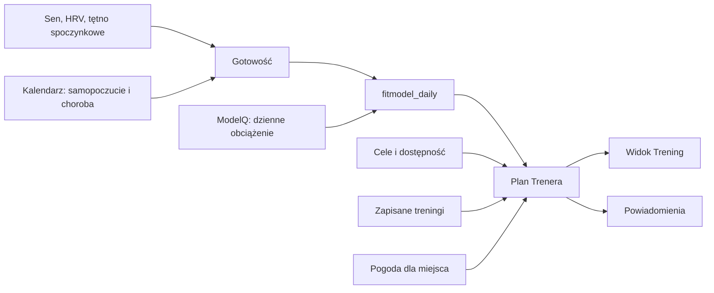

Gotowość ModelQ korzysta z HRV, tętna spoczynkowego i długości snu; kod podaje 60-dniową bazę i medianę z 3 dni. Wpisy samopoczucia lub choroby mogą zmienić `readiness_effective`. Status dnia dodatkowo łączy średnią gotowość, ruchomą normę pulsu, skok obciążenia i czas od choroby. `real_load` używa gotowości obiektywnej, Body Battery, choroby i samopoczucia do korekty zmęczenia faktycznego; puls jest już częścią gotowości i nie jest tam liczony drugi raz. Trener czyta dane z `fitmodel_daily`, a także kalendarz, cele, dostępność i sesje z tabel `trainer_*`. Dla planu pobiera prognozę dla zapisanego miejsca.

### Raport jazdy i Garaż

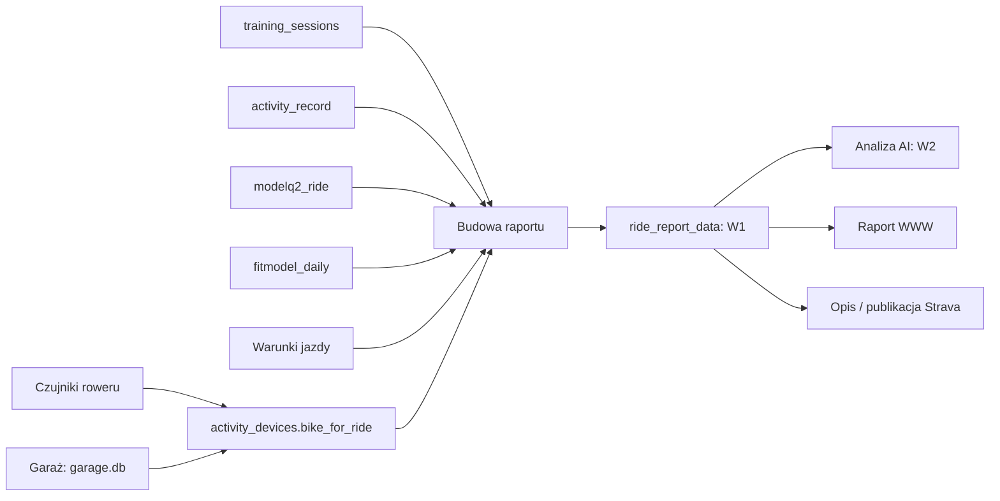

Budowniczy raportu czyta próbki jazdy, wynik ModelQ i dzienne dane formy. Rozpoznanie roweru przez `bike_for_ride` opiera się na identyfikatorach czujników, a mapowanie nazwy roweru pochodzi z danych Garażu. W1 jest zapisywane w `ride_report_data`; W2, jeśli powstanie, jest odrębnym zapisem. Strona czyta gotowy raport, a publikacja Strava wybiera z niego własny zestaw faktów.

W raporcie odróżniaj dane zmierzone od opisów dołączonych później. Próbki aktywności zasilają przebieg i wykres; dzienny próg ModelQ wpływa na IF; wynik W′bal może pochodzić z Karoo/QExt2 albo z odtworzenia. Nawierzchnia, pogoda, rozpoznanie roweru, porównanie planu oraz analiza AI są dodatkowymi elementami i nie muszą wystąpić w każdym raporcie. Zobacz [przegląd Raportu jazdy](raport-jazdy/index.md), [źródła W′bal](raport-jazdy/wprime-bal.md) i [porównanie planu](raport-jazdy/plan-wykonanie.md).

### Trasa, pogoda i ubiór

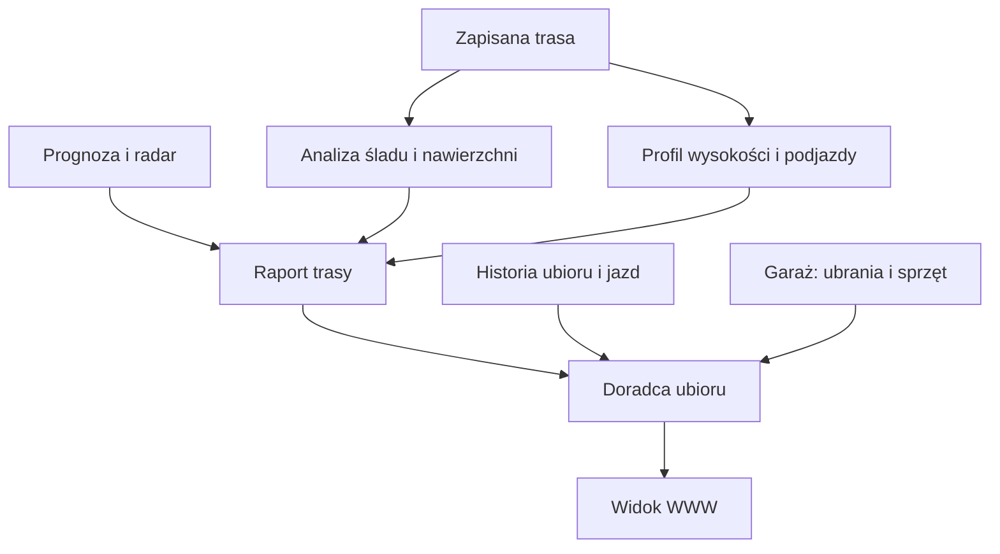

Silnik trasy analizuje zapisany ślad i zapisuje wyniki w warstwach trasowych. Pogoda jest dołączana do raportu jako osobna informacja. Doradca ubioru łączy plan jazdy i prognozę z rzeczami w Garażu oraz historią „W czym jechałem”. To osobny przepływ od analizy obciążeń ModelQ.

### Pogoda — szczegółowe powiązania

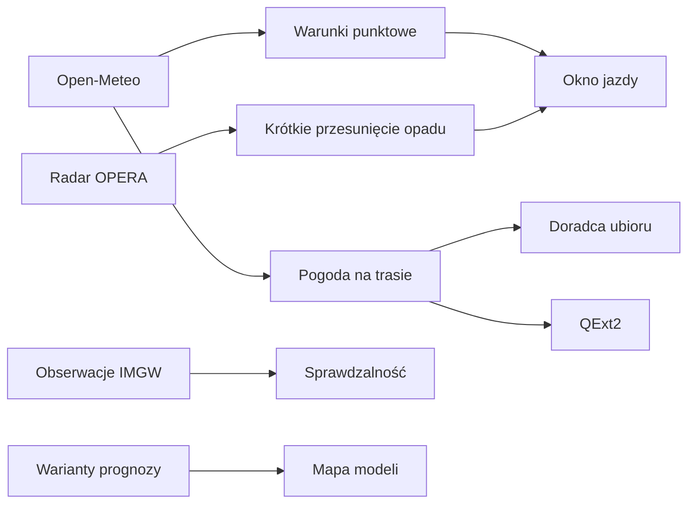

Pogoda punktowa opisuje wybrane miejsce. Pogoda trasy dopasowuje warunki do przewidywanego czasu przejazdu. Radar pokazuje opad już zarejestrowany, a dalszy horyzont przejmuje prognoza modelowa. Ocena dawnych prognoz może wpływać na wybór modelu; sama nie przewiduje dzisiejszej pogody.

Szczegóły: [przegląd Pogody](pogoda/index.md), [prognoza](pogoda/prognoza.md), [radar](pogoda/radar.md), [sprawdzalność](pogoda/sprawdzalnosc.md), [pogoda na trasie](pogoda/pogoda-na-trasie.md) i [QExt2](pogoda/qext2.md).

### Wpływ pogody na Trenera i jazdę

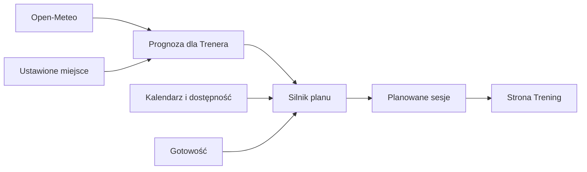

### Macierz wpływów

| Moduł A | Wpływa na moduł B | Przez jaki wynik lub dane |
|---|---|---|
| Karoo / import aktywności | ModelQ | `training_sessions` oraz próbki `activity_record` |
| Kotwica ModelQ i obciążenie z poprzednich dni | Dzienna sygnatura | `modelq2_anchor` oraz historia CTL/TL_high |
| `activity_record` + sygnatura ModelQ | Obciążenie dnia | `modelq2_ride.xss_low`, `xss_high`, `xss_peak`, `xss_total` |
| ModelQ | Forma i raport jazdy | `fitmodel_daily` oraz `modelq2_ride` |
| Sen, HRV, tętno spoczynkowe | Gotowość | `fitmodel_daily.readiness_score` |
| Gotowość z 3 dni, norma pulsu, skok obciążenia, choroba | Status dnia | `fitmodel_daily.day_status` i `day_status_note` |
| Gotowość, Body Battery, choroba, samopoczucie | Zmęczenie faktyczne | `body_load`, `atl_real`, `tsb_real` |
| Pomiary masy | Wykres masy | `body_measurements` oraz dzienne `weight_kg` |
| Kalendarz: samopoczucie i choroba | Skorygowana gotowość | `fitmodel_daily.readiness_effective` |
| Gotowość, kalendarz, cele, dostępność | Trener | `fitmodel_daily` i `qbot_v2.trainer_*` |
| Pogoda | Trener i raport trasy | Prognoza pobierana przez silnik planu / dane pogodowe raportu |
| `qbot_wx` i dobór modelu | Prognoza punktowa i silnik pogody trasy | Odpowiedzi Open-Meteo, cache oraz modele wybrane dla parametru i horyzontu |
| OPERA i ruch opadu | Radar punktowy, alert deszczowy i QExt2 | Klatki radarowe oraz oszacowanie ruchu użyte do krótkiego nowcastu |
| IMGW + prognozy Previous Runs | Przydział modelu pogodowego | `qbot_pogoda_verif.przydzial` dobiera model dla części parametrów i horyzontów |
| Silnik pogody trasy | Analiza trasy i QExt2 | Pogoda segmentowa dopasowana do przewidywanego czasu przejazdu |
| Pozycja Karoo / plan Trenera + radar | Ostrzeżenie o deszczu | `qbot_pogoda_alert.check` i `qbot_v2.pogoda_alert` |
| Prognoza punktowa + radar + dostępność Trenera | Okno jazdy | Wyniki wariantów startu prezentowane na stronie Pogoda |
| Trasa i ślad | Raport trasy | tabele wyników trasowych, w tym warstwy nawierzchni i wysokości |
| Czujniki oraz Garaż | Raport jazdy | `bike_for_ride`, mapowanie roweru i komponenty raportu |
| Raport jazdy W1 | Strona raportu, analiza AI W2 i publikacja Strava | `qbot_v2.ride_report_data.w1_json` |
| Raport jazdy W1 | Analiza AI W2 | `qbot_v2.ride_report_data.w2_json` (opcjonalne) |
| Garaż: ubrania, historia jazd i prognoza | Doradca ubioru | `garage.db` oraz `ride_report_data.w1_json` |

## Liczby liczone w więcej niż jednym miejscu

- **Obciążenie XSS:** `modelq2_ride.xss_total` jest wynikiem kanonicznym nowego ModelQ i jest używany do obciążenia oraz raportu jazdy. Równolegle starszy `fitmodel.wbal_replay` zapisuje własne `fitmodel_wbal_ride.xss`. Komentarz w `ride_report_builder` wyraźnie odróżnia te skale i wskazuje ModelQ jako kanon obciążenia. Nie należy utożsamiać tych liczb.
- **Forma i świeżość:** publikacja ModelQ zapisuje surowe `ctl_xss`, `atl_raw`, `tsb_raw`, a także wartości początkowe `atl_plus`, `tsb_plus`. Następnie `apply_hidden_fatigue` koryguje wartości `*_plus`; dodatkowo `fitmodel.real_load` oblicza `atl_real`, `tsb_real`, `ctl_real` na podstawie obciążenia ciała. Konsumenci często wybierają `COALESCE(atl_real, atl_plus, atl_raw)`. To różne warianty wyniku, a nie jeden identyczny TSB. Raporty wskazują wariant odczytywany w danym miejscu.
- **W′bal:** `modelq2_ride.min_wbal_pct` pochodzi z odtworzenia mocy i sygnatury. Raport może też odczytać wartości z Karoo/QExt2, a kod raportu potrafi wyliczyć krzywą na `activity_record`. Są to alternatywne ścieżki źródła. Komentarze raportu opisują źródło jako oznaczone danymi pochodzenia. Zbieżność wszystkich wariantów dla każdej jazdy nie jest gwarantowana ani potwierdzona.
- **Gotowość:** `readiness_score` opiera się na danych wellness, a `readiness_effective` może uwzględniać wpisy samopoczucia lub choroby. `day_status`, sygnały sezonu i decyzje Trenera mogą ponownie agregować gotowość z kilku dni, ale są to osobne podsumowania, nie kopia pojedynczego wyniku.
- **Pogoda:** pojawia się w analizie trasy, planie Trenera i poradzie ubioru. Odbiorcy używają jej do różnych decyzji; kod nie wskazuje jednej wspólnej, niezmiennej liczby dla wszystkich tych miejsc.

## Pojedyncze punkty awarii

- **Import aktywności i `activity_record`:** bez próbek mocy brakuje danych wejściowych do odtworzenia W′bal i XSS z mocy dla danej jazdy. Podsumowanie `training_sessions` może nadal istnieć, ale nie zastępuje strumienia sekundowego dla tych obliczeń.
- **Codzienny pipeline ModelQ:** brak publikacji do `fitmodel_daily` odcina lub opóźnia świeże wartości formy oraz dane czytane przez Trenera i raport jazdy.
- **Dane wellness:** brak HRV, tętna spoczynkowego i snu może uniemożliwić obliczenie gotowości; kod zwraca brak wyniku, jeśli nie ma wystarczającej bazy.
- **Baza Trenera i Kalendarz:** bez zapisanych celów, dostępności, kalendarza lub sesji silnik ma mniej danych do ułożenia planu. Prognoza jest pobierana osobno i jej brak nie usuwa zapisanej historii jazd.
- **Dane trasy lub usług mapowych:** bez trasy nie ma czego analizować; niedostępność źródeł zewnętrznych może ograniczyć wzbogacenie nawierzchni, punktów lub pogody. Architektura nawierzchni ma tryb fail-open, więc brak zewnętrznego źródła nie zawsze zatrzymuje cały raport.
- **Garaż / mapowanie czujnika:** awaria lub brak mapowania może pozbawić raport rozpoznanej nazwy roweru i doradcę ubioru danych o posiadanym sprzęcie. Pozostałe części raportu bazujące na jeździe i ModelQ są osobnymi wejściami.
- **`ride_report_data`:** jeśli raport jazdy nie zostanie zbudowany, strona i odbiorcy korzystający z gotowego raportu nie dostaną jego zapisanych sekcji.

## Ograniczenia i pułapki

- Powyższe połączenia sprawdzono w kodzie. Nie każda zależność jest obowiązkowa: część danych jest wzbogaceniem, a część ma zapasowe źródło.
- Strzałki nie opisują harmonogramu odświeżania. Harmonogramy automatów są zebrane w [mapie serwisu](mapa-serwisu.md).
- W dokumentacji i nazwach kolumn bywają pozostałości starszych modeli. Przykładowo `cp_modelq_w` przechowuje TP, co kod jawnie opisuje jako historyczną nazwę.
- Nie potwierdzono wspólnego mechanizmu przekazującego opis jazdy z raportu do Stravy we wszystkich przypadkach. Publikacja Strava i raport jazdy są osobnymi etapami; integrację mapowania roweru w publikacji opisuje `qbot_strava_publish.py`.

## Wpływa na

- ModelQ wpływa na dzienne obciążenie, widok formy i wybrane elementy raportu jazdy.
- Gotowość oraz kalendarz wpływają na sygnały używane przez Trenera.
- Pogoda wpływa na kontekst planu i analizę warunków jazdy.
- Garaż może wpływać na opis roweru w raporcie i dobór ubioru.

## Zależy od

- ModelQ zależy od zapisanych aktywności, próbek mocy oraz wyznaczonej sygnatury.
- Gotowość zależy od wellness; korekta subiektywna zależy od wpisów kalendarza.
- Trener zależy od danych planu i kalendarza, a pogodę pobiera jako osobne wejście.
- Raport jazdy zależy od FIT/próbek aktywności; wybrane sekcje dodatkowo od ModelQ, danych trasy, pogody i Garażu. Strona zależy od zapisanego W1; analiza AI wymaga osobnego W2.

## Powiązane hasła

### Garaż

| Dane lub funkcja | Zależy od | Wpływa na | Hasło |
|---|---|---|---|
| Lista rowerów i części | Wpisów właściciela w Garażu | Opis sprzętu i wybór wyposażenia trasy | [Sprzęt](garaz/sprzet.md) |
| Koła i opony | Przypisania opony do koła i przodu/tyłu | Informacje o wyposażeniu wybranego roweru | [Koła i opony](garaz/kola-opony.md) |
| Rozpoznanie roweru | Identyfikatorów czujników w zapisanej jeździe i przypisań | Nazwy roweru w raporcie jazdy | [Rozpoznawanie roweru](garaz/rozpoznawanie-roweru.md) |
| Dobór roweru | Trasy, pogody i zapisów Garażu | Propozycji roweru oraz świateł/błotników | [Wybór roweru](garaz/wybor-roweru.md) |
| Doradca ubioru | Prognozy, rzeczy, historii i obserwacji | Propozycji ubioru dla dnia trasy | [Doradca ubioru](garaz/doradca-ubioru.md) |
| Fitting | Geometrii, części, regulacji i pomiarów | Rysunku pozycji i orientacyjnych kątów | [Fitting](garaz/fitting.md) |
| Notatki warsztatowe | Wpisów właściciela | Prywatnej historii prac; nie ma potwierdzonego wpływu na rekomendacje | [Notatki](garaz/notatki-warsztatowe.md) |
| Przypomnienia zakupowe | Ilości, zużycia i harmonogramu suplementu | Dzwonka strony i porannej wiadomości | [Przypomnienia](garaz/przypomnienia-zakupowe.md) |

- [Mapa serwisu](mapa-serwisu.md)
- [ModelQ](modelq/index.md)
- [Kotwice ModelQ](modelq/kotwice.md)
- [W′bal](modelq/wprime-bal.md)
- [XSS](modelq/xss.md)
- [Forma](forma/index.md)
- [Trener](trener/index.md)
- [Raport jazdy](raport-jazdy/index.md)
- [Pogoda](pogoda/index.md)
- [Garaż](garaz/index.md)
- [QExt2](qext2/index.md)
- [Słowniczek](slowniczek.md)

## Zrodla

- `/opt/qbot/app/fitmodel/modelq2/publish.py` — `ingest_new_rides_xss`, `publish_to_daily`, `run_daily_v2`.
- `/opt/qbot/app/fitmodel/modelq2/xss.py` — `compute_xss`, podział Low/High/Peak.
- `/opt/qbot/app/fitmodel/modelq2/training_load.py` — `build_load_series`, obciążenie i regeneracja.
- `/opt/qbot/app/fitmodel/readiness.py` — `compute_readiness`, `save_readiness`.
- `/opt/qbot/app/fitmodel/real_load.py` — obliczenie `atl_real`, `tsb_real`, `ctl_real`.
- `/opt/qbot/app/fitmodel/modelq2/hidden_fatigue.py` — korekta `atl_plus`, `tsb_plus`.
- `/opt/qbot/app/qbot_trener_engine.py` — `build_context`, czytanie gotowości, kalendarza, sesji i prognozy.
- `/opt/qbot/app/qbot_trener_stats.py` — `weather_auto_cached`, automatyczna pogoda Trenera.
- `/opt/qbot/app/qbot3/rides/ride_report_builder.py` — budowa i zapis `ride_report_data`, źródła XSS i W′bal, odczyt roweru.
- `/opt/qbot/app/qbot3/rides/activity_devices.py` — `bike_for_ride`.
- `/opt/qbot/app/qbot3/routes/route_report_canonical.py` — odczyt kanonicznych danych raportu trasy i `fitmodel_daily`.
- `/opt/qbot/app/qbot3/routes/outfit_advisor.py` — `garage.db`, historia ubioru i warunki raportu jazdy.
- `/opt/qbot/app/qbot_strava_publish.py` — publikacja Strava i mapowanie roweru.
- `/opt/qbot/app/docs/architecture/QBOT_ARCHITEKTURA_QBOT3.md` — warstwy tras i architektura QBot3.
# Trener

- `trener/plan-tygodnia.md` zależy od: `trener/sezon.md`, `trener/dostepnosc.md`, `trener/gotowosc.md`, `trener/xss.md`, wpisów Kalendarza i pogody.
- `trener/kalendarz.md` pokazuje dane z planu `trener/plan-tygodnia.md` oraz wykonane aktywności; wpisy i trasy Kalendarza mogą zmienić plan.
- `trener/trasy.md` dostarcza planowi trening rowerowy; jego dystans, czas i XSS wpływają na obciążenie tygodnia.
- `trener/powiadomienia.md` odczytuje plan i stan zmian; przyciski mogą uruchomić akcje planu.
- `trener/bilans-waga.md` korzysta z dziennika jedzenia i wydatku energii oraz pomiarów masy; aktywny etap celu wagi wyznacza tempo docelowe.
- `trener/cele.md` dostarcza daty i priorytety celów; cele wyprawowe A są wejściem do wyznaczania etapów sezonu.
- `trener/korekta-pogodowa.md` zależy od prognozy godzinowej, miejsca i zapisanej sesji; dopiero odpowiedź właściciela zmienia dzień lub porę treningu.
- `trener/adaptacja.md` zależy od dopasowania zapisu aktywności do sesji; może utworzyć zmianę do akceptacji, a nie automatycznie przepisać dowolną historię.
- `trener/cwiczenia-sciaga.md` zależy od zaplanowanej sesji siłowej i dostępnych ćwiczeń; wyjaśnia szczegóły zestawu.
- `trener/edycja-dnia.md` opisuje wpisy Kalendarza, które ograniczają plan albo przekazują sygnał samopoczucia/choroby.
- Widok Kalendarza przedstawia plan, wykonanie i wydarzenia jako odrębne rodzaje wpisu. Zrzut 12.10–18.10.2026 pokazuje sumę planu 6,7 h, wykonania 6,6 h, około 282 planowane XSS oraz cel tygodnia 5 h.

# Trasy

- `trasy/analiza-trasy.md` zależy od geometrii i wybranej wersji w route store oraz od warstw dostępnych dla tej wersji; pogodę pobiera osobny silnik.
- `trasy/profil-trasy.md` zależy od próbek wysokości DEM i zapisanych zdarzeń podjazdów; profil i podjazdy wpływają na raport oraz wejście modelu czasu.
- `trasy/nawierzchnia.md` zależy od geometrii, danych OSM i dopasowania silnika; wpływa na kolory raportu, klasyfikację odcinków i model czasu.
- `trasy/czas-przejazdu.md` zależy od kanonicznych segmentów trasy, konfiguracji modelu prędkości oraz deklarowanych długich postojów; zwraca ruch i czas łączny.
- `trasy/punkty-na-trasie.md` zależy od warstwy `route_poi_layer`; dla tras dziennych może dziedziczyć wycinek od rodzica.
- `trasy/atrakcje.md` zależy od wyników źródeł, oceny jakości i publikacji w `route_attraction_run`/`route_attraction_layer`; tę samą publikację czytają Analiza i Planer.
- `trasy/planer-wyprawy.md` zależy od geometrii rodzica, punktów podziału i route store; tworzy dzienne trasy oraz dziedziczy fragmenty warstw.
- `trasy/naprawa-tras.md` zależy od geometrii i zapisanej klasyfikacji nawierzchni; propozycję objazdu oblicza osobno Valhalla.
- `trasy/store-i-wersje.md` dostarcza wersje i dane źródłowe Analizie, profilowi, nawierzchni, naprawie i Planerowi.
- `trasy/potwierdzenia-telegram.md` zależy od odpowiedzi na akcję oczekującą i workerów precompute; po zakończeniu zapisuje audyt oraz próbuje wysłać powiadomienie.

# Zdrowie

- `zdrowie/dziennik.md` zasila sumy przyjętej energii i makr; cel kcal porównuje te sumy z wydatkiem.
- `zdrowie/cel-kcal.md` zależy od wydatku, planu tygodnia i kalibracji z ważeń; wpływa na dokładkę Brokuła i podział energii treningowej.
- `zdrowie/bialko.md` zależy od makr zapisanych posiłków; jego cel jest używany w podsumowaniu dnia i planie weekendu.
- `zdrowie/okno-10-20.md` zależy od potwierdzenia, godzin w dzienniku, planu treningu i wydarzeń; wpływa na licznik okna Passy.
- `zdrowie/paliwo-rower.md` zależy od czasu sesji rowerowej; wpływa na podział celu kcal na jedzenie podczas jazdy i po niej.
- `zdrowie/brokul.md` dostarcza planowane menu; tylko posiłki oznaczone jako zjedzone trafiają do bilansu w dniu zjedzenia.
- `zdrowie/weekend.md` zależy od celu dnia, treningów i preferencji; zatwierdzone posiłki mogą trafić do karty dnia.
- `zdrowie/suplementy.md` zależy od listy i ręcznych potwierdzeń; dostarcza listę do raportu dla lekarza oraz danych do porównania nocy.
- `zdrowie/serce.md` zależy od importów Garmina/Withings i próbek aktywności; sygnały i pomiary trafiają do karty oraz raportu dla lekarza.
- `zdrowie/passa.md` zależy od zamknięcia dni, okna, planu Trenera, ważeń i bilansu; wpływa na liczniki oraz kamienie milowe.
- `zdrowie/sen.md` zależy od importu Garmina; wynik snu jest używany w gotowości i grupowaniu porównań tygodniowych.
- `zdrowie/energia.md` zależy od zapisów jedzenia i energii z aktywności/spoczynku; wpływa na cel i bilans.
- `zdrowie/masa-ciala.md` zależy od pomiarów Withings/Garmin; rzeczywiste ważenia wpływają na trend i kalibrację bilansu.

# QExt2 i Karoo

- `qext2/index.md` zbiera drogę od danych przygotowanych przez QBot, przez ekran Karoo, aż po plik jazdy wracający do podsumowania QBota; opis dotyczy tylko wymiany z perspektywy właściciela QBota.
- `qext2/komunikaty.md` zależy od konfiguracji komunikatów QBota oraz trasy, prognozy i pomiarów Karoo; wpływa na treść, kolor, kolejność i czas pokazywania paska KOKPIT 2.
- `qext2/dane-trasy.md` zależy od rozpoznania trasy, gotowych profili nawierzchni i punktów albo od jazd spełniających filtry typowego EF; wpływa na podpowiedzi nawigacyjne i porównania w statystykach Karoo.
- `qext2/kokpit2.md` zależy od konfiguracji `qext2_config.py` i pobrania `/ride-readiness`; ustawienia wpływają na komunikaty i kolory KOKPIT 2.
- `qext2/tryb-auto.md` zależy od danych wejściowych `/ride-readiness` z QBota oraz RSRV, ETA i historii pomiarów Karoo; wybrany tryb wpływa na pułap opisany w `qext2/pacing.md`.
- `qext2/pacing.md` zależy od progu i W′ przekazanych z QBota oraz bieżących pomiarów i rezerwy QExt2; wpływa na kolor i alarm mocy KOKPIT 2.
- `qext2/pole-dynamiczne.md` zależy od ustawienia DYNAMIC/AERO i pomiarów Karoo; pola AERO trafiają do FIT, ale parser QBota nie zapisuje ich obecnie do podsumowania.
- `qext2/pogoda-info.md` zależy od pogody tras QBota lub warunków punktowych; tryb jazdy przekazuje pozycję, trasę i kilometr do odświeżania prognozy.
- `qext2/brama.md` zależy od tokena, GPS, punktu bramy i usługi sterującej; żądanie z Karoo podlega weryfikacji QBota.
- `qext2/pola-fit.md` zależy od FIT z polami QExt2 i zgodności nazw kontraktu z parserem; podsumowanie zasila dalsze analizy tylko tam, gdzie kod jawnie je wybiera.
- `qext2/przeplyw-jazdy.md` łączy odpowiedź `/ride-readiness`, usługi trasowe i pogodowe QBotu oraz import FIT; szczegóły są opisane w hasłach powyżej.

Szczegółowe ścieżki: [pole dynamiczne](qext2/pole-dynamiczne.md) nie ma obecnie potwierdzonego wpływu na analizę QBota, bo pola AERO nie są zachowywane w podsumowaniu. [Pogoda INFO](qext2/pogoda-info.md) korzysta z prognozy punktowej lub trasowej, ale nie znaleziono w bazie przykładowej odpowiedzi odebranej przez urządzenie. [Brama](qext2/brama.md) jest osobnym żądaniem sterującym; jej użycie wymaga tokenu, położenia i potwierdzenia, a nie wynika z samego pobrania danych gotowości.

# Połączenia

- `polaczenia/garmin.md` zasila Formę, Zdrowie, ModelQ i raport jazdy danymi zależnie od rodzaju pomiaru.
- `polaczenia/hammerhead-garmin.md` przekazuje aktywności do Garmina; Garmin może następnie dostarczyć je do importu QBota.
- `polaczenia/withings.md` przekazuje pomiary do Garmina; importy wellness QBota mogą korzystać z danych dostępnych w Garminie.
- `polaczenia/komoot.md` dostarcza trasy do analizy i planowania.
- `polaczenia/rwgps.md` dostarcza geometrię trasy do magazynu i analizy tras.
- `polaczenia/strava.md` wiąże aktywność Stravy z jazdą i raportem QBota; automat może uzupełnić opis oraz rower.
- `polaczenia/xert.md` zależy od importowanych migawek i zasila porównanie ModelQ, ale nie jego parametry.
- `polaczenia/intervals-icu.md` i `polaczenia/harmonogram-importow.md` mają otwarte potwierdzenie aktywnego harmonogramu.

### Garaż, zakupy i ubiór

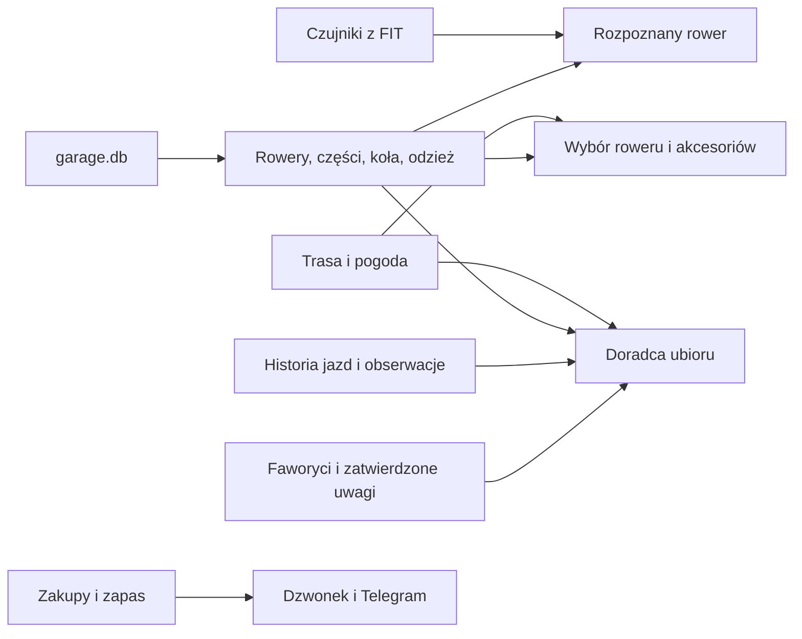

- `gear_kit` czyta rowery, koła, opony i wyposażenie z `garage.db`; wynik wyboru roweru trafia do `qbot_v2.route_kit`. Stan nawierzchni po opadach może być przekazany do warunków ubioru.
- `outfit_advisor` korzysta z odzieży, audytu i historii ubioru. `gear_obs` dostarcza podsumowanie `co_wiemy`; `outfit_fav` i `outfit_notes` przekazują wybory oraz zatwierdzone uwagi.
- `activity_devices.bike_for_ride` porównuje czujniki z `qbot_v2.activity_device` i mapą `qbot_v2.bike_sensor`.
- `qbot_zakupy_api` przechowuje plany i zakupione pozycje w `shop_items`; przypomnienia trafiają do Dzwonka i porannej wiadomości Telegram.

## System

- `system/status.md` → zależy od plików stanu, logów, usług systemd i `qbot_status_checks.all_checks`; wynik audytu tygodniowego jest jedną z pozycji Statusu.
- `system/centrum-powiadomien.md` → zależy od `qbot_v2.notif`, źródeł `qbot_notif.py` i API `/api/notif`; widok jest w `nav.js`.
- `system/dostep-demo.md` → zależy od `qbot_web_auth.py`, sesji i wniosków w `qbot_v2`; ogranicza dostęp do stron i API.
- `system/audyt-tygodniowy.md` → timer uruchamia `scripts/weekly_audit.py`; wynik trafia do `state/weekly_audit.json`, który czyta Status.
- `system/kopie-bazy.md` → skrypt `scripts/qbot_backup.sh` tworzy pliki dla PostgreSQL; `qbot_status_checks.backup` odczytuje wynik usługi.
- `system/bezpieczniki.md` → obejmuje odrębne mechanizmy dostępu demo, testów i kontroli Statusu.
- `system/paleta-ui.md` → `ui2-tokens.css` wpływa na wygląd stron używających UI2.
- `system/warstwa-legacy.md` → licznik legacy zapisuje log; jego podsumowanie jest kontrolą w Statusie, aktualnie ze stanem `off`.
- `system/strony-www.md` → zależy od kontroli dostępu, nawigacji i danych poszczególnych ekranów; indeks widoków znajduje się w `mapa-serwisu.md`.
- `system/automaty.md` → harmonogramy zapisują stany czytane przez Status; częstotliwości w kodzie nie potwierdzają samodzielnie aktywności timerów.
- `system/dane-i-prywatnosc.md` → opisuje sprawdzone granice sesji demo oraz miejsca kopii i historii; pełna retencja pozostaje nieustalona.
- `system/kontakty.md` → zakładka SETUP odsyła do API grup adresów; jej pełnego widoku ani użycia nie zweryfikowano.

Przepływ działu: automaty → znaczniki i pliki wyniku → Status; zdarzenia modułów → dzwonek; dostęp demo → ograniczony odczyt WWW. Telegram działa osobno od ustawień dzwonka. Paleta UI wpływa na prezentację, nie na wartości danych.

## Forma — szczegółowe zależności

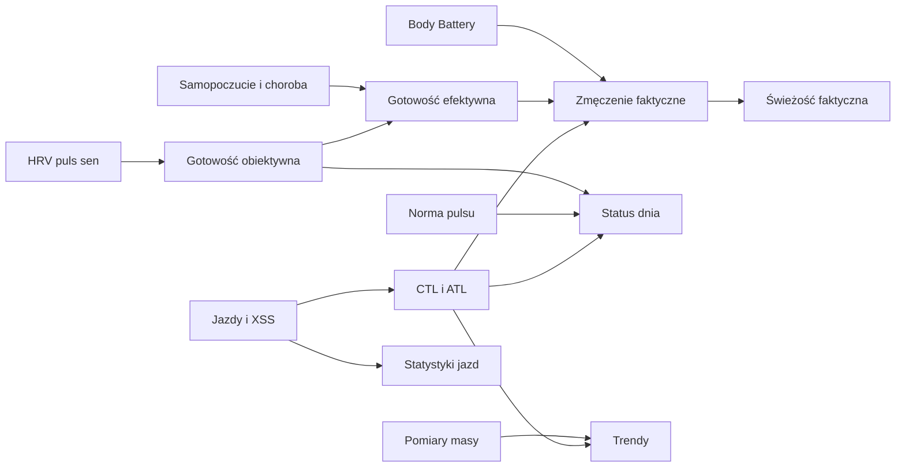

| Wynik | Główne wejścia | Odbiorca |
|---|---|---|
| Gotowość obiektywna | HRV, puls spoczynkowy, długość snu | status dnia i faktyczne zmęczenie |
| Gotowość efektywna | gotowość obiektywna, samopoczucie, choroba | Dziennik i wybrane podsumowania |
| Faktyczne obciążenie krótkie | obciążenie, gotowość, Body Battery, choroba, samopoczucie | świeżość faktyczna |
| Status dnia | gotowość z 3 dni, norma pulsu, skok obciążenia, okres po chorobie | Dziennik i Trener |
| Trendy masy | pomiary ciała oraz seria dzienna | wykresy Formy i podsumowania żywieniowe |
| Statystyki jazd | zapisane aktywności, daty i filtr sportu | zakładka Statystyki |

Wartości z 18.10.2026 pokazują, dlaczego należy zachować rozróżnienie: CTL 58,0; ATL surowe 60,1; ATL skorygowane 74,6; ATL faktyczne 74,5; TSB faktyczne −16,5; gotowość obiektywna −0,962; gotowość efektywna −1,112; status dnia „w normie”. To osobne wyniki, a nie sprzeczne kopie jednego wskaźnika.

Szczegóły: [przegląd Formy](forma/index.md), [gotowość](forma/gotowosc.md), [status dnia](forma/status-dnia.md), [obciążenie i świeżość](forma/ctl-atl-tsb.md), [Body Battery](forma/body-battery.md), [wykresy](forma/wykresy.md).

## Trasy — szczegółowe zależności

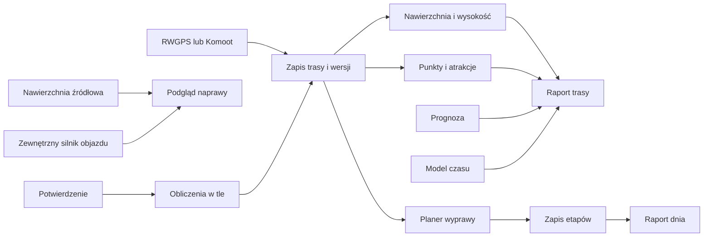

Strona raportu składa wynik z wybranej wersji trasy, warstw obliczonych dla tej wersji, prognozy oraz czasu przejazdu. Logistyczne punkty i atrakcje są dwiema różnymi warstwami. Planer zapisuje etapy, które można później wybierać osobno. Naprawa czyta oznaczenia nawierzchni, ale proponowany przebieg ocenia zewnętrzny silnik trasowania. Telegram może uruchomić obliczenia po potwierdzeniu; wiadomość końcowa jest osobnym krokiem.

| Element | Zależy od | Wpływa na | Hasło |
|---|---|---|---|
| Magazyn tras | identyfikatora, geometrii i wersji | wybór właściwych warstw | [Store i wersje](trasy/store-i-wersje.md) |
| Nawierzchnia | geometrii, mapy OSM i jakości dopasowania | mapa, wykres, czas i naprawa | [Nawierzchnia](trasy/nawierzchnia.md) |
| Profil | geometrii i próbek wysokości | wykres oraz lista podjazdów | [Profil trasy](trasy/profil-trasy.md) |
| Punkty logistyczne | warstwy punktów blisko przebiegu | zaopatrzenie na mapie i etapach | [Punkty](trasy/punkty-na-trasie.md) |
| Atrakcje | źródeł kandydatów, rankingu i publikacji | zakładka atrakcji oraz Planer | [Atrakcje](trasy/atrakcje.md) |
| Czas przejazdu | segmentów, ustawień prędkości i postojów | czas ruchu, suma i profil godzinowy | [Czas](trasy/czas-przejazdu.md) |
| Raport dnia | etapu i wymaganych parametrów strony | widok pojedynczego dnia; działanie po poprawnym otwarciu niepotwierdzone | [Raport dnia](trasy/raport-dnia.md) |
| Kwadraty mapy | geometrii i stanu pól konta | dodatkowa nakładka oraz licznik w raporcie | [Kwadraty na mapie](trasy/kwadraty-mapy.md) |

Przykład bazy z 05.10.2026: trasa `komoot-3331694546` miała 182,6 km, 3654 próbki wysokości, 23 zdarzenia podjazdu oraz 209 fragmentów nawierzchni. Raport nie tworzy tych źródeł od zera przy każdym wyświetleniu; korzysta z zapisanych warstw powiązanych z wersją.

## Zdrowie — widok i przepływ

| Element | Zależy od | Wpływa na | Hasło |
|---|---|---|---|
| Dziennik jedzenia | wpisów, menu i potwierdzeń | bilans, cel, Passę | [Dziennik](zdrowie/dziennik.md) |
| Cel kcal | wydatku, kalibracji i planu tygodnia | pozostałej energii i planu posiłków | [Cel kcal](zdrowie/cel-kcal.md) |
| Paliwo rowerowe | planu jazdy i czasu sesji | porcji węglowodanów na trening | [Paliwo](zdrowie/paliwo-rower.md) |
| Obwody | ręcznego pomiaru | wykresu Ciała i sygnałów Serca | [Obwody](zdrowie/obwody.md) |
| Sen | synchronizacji Garmina | gotowości i porównań tygodnia | [Sen](zdrowie/sen.md) |
| Suplementy | planu dawek i potwierdzeń | regularności i raportu lekarza | [Suplementy](zdrowie/suplementy.md) |
| Plan weekendu | celów dnia, jazdy i preferencji | propozycji oraz zakupów | [Weekend](zdrowie/weekend.md) |

## Albert i kanały rozmowy

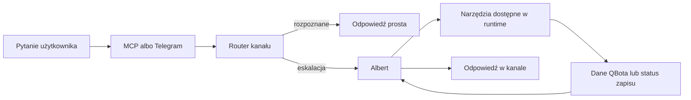

| Element | Zależy od | Wpływa na | Hasło |
|---|---|---|---|
| Albert | pytania, promptu, rejestru narzędzi i usług | odpowiedzi i wybranych zapisów | [Albert](albert/index.md) |
| Routing | kanału, reguł i wyniku routera | tego, czy odpowie router czy Albert | [Routing](albert/routing.md) |
| Narzędzia | rejestru i zabezpieczeń | danych odpowiedzi lub statusu akcji | [Narzędzia](albert/narzedzia.md) |
| Pamięć | plików JSONL, próby zapisu do bazy i osobnego notesu planowania | późniejszych odpowiedzi o ustaleniach | [Pamięć](albert/pamiec.md) |
| MCP | adaptera oraz klienta | dostępu do pytania i ograniczonego odczytu | [MCP](albert/mcp.md) |
| Telegram | webhooka, obsługi rozmowy i zapytania QBot | odpowiedzi oraz komend Telegrama | [Telegram](albert/telegram.md) |
| Ograniczenia | reguł runtime, narzędzi i kanału | dozwolonych czynności i treści odpowiedzi | [Ograniczenia](albert/ograniczenia.md) |

## Połączenia — źródła i kierunki danych

| Połączenie | Dane wejściowe lub wyjściowe | Główne zastosowanie | Hasło |
|---|---|---|---|
| Hammerhead → Garmin | aktywność z Karoo jako TACX | następnie Garmin udostępnia jazdę QBotowi | [Hammerhead → Garmin](polaczenia/hammerhead-garmin.md) |
| Garmin → QBot | jazdy i wybrane pomiary wellness | Forma, Zdrowie, ModelQ i raport jazdy | [Garmin](polaczenia/garmin.md) |
| Withings → Garmin → QBot | masa, skład ciała, ciśnienie | pomiary ciała w dalszych ekranach | [Withings](polaczenia/withings.md) |
| intervals.icu ↔ QBot | wellness do QBota; TP/LTHR w drugą stronę | pomiary i progi przekazane do Karoo przez Hammerhead | [intervals.icu](polaczenia/intervals-icu.md) |
| Komoot → QBot | nowe trasy | wykrycie i analiza trasy | [Komoot](polaczenia/komoot.md) |
| RWGPS → QBot | trasy i webhooki | zapis artefaktu i analiza trasy | [RWGPS](polaczenia/rwgps.md) |
| Strava ↔ QBot | aktywności, zdjęcia, opis i przypisany rower | galeria oraz uzupełnienie aktywności | [Strava](polaczenia/strava.md) |
| Xert → QBot | profil i benchmark | oddzielne porównanie ModelQ | [Xert](polaczenia/xert.md) |

Opis częstotliwości nie jest dowodem, że aktywny cron lub timer działa. Zobacz [harmonogram importów](polaczenia/harmonogram-importow.md) i [Status systemu](system/status.md).

Uwaga: dla MCP dokument architektury i lista narzędzi budowana w kodzie nie są zgodne. Do ustalenia aktywnej listy potrzebna jest odpowiedź działającego serwera.
