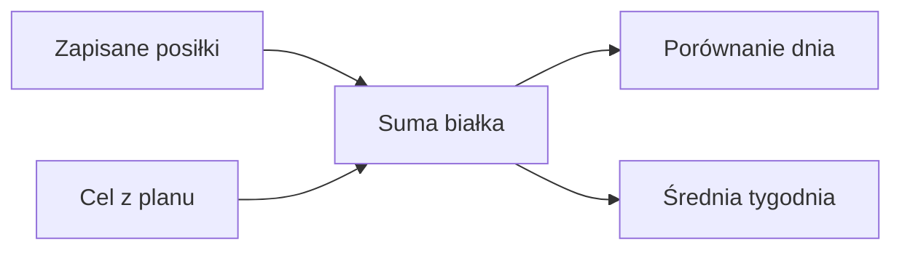

# Białko

## Co to jest

Białko jest jednym ze składników pokazywanych w dzienniku. W planie QBota ma stały cel 160 g dziennie.

## Po co

Pomaga sprawdzić, czy zapisane posiłki zbliżają się do przyjętego celu.

## Skąd dane

Gramy białka pochodzą z menu Brokuła i wpisów jedzenia. Wartości dzienne są sumowane w podsumowaniu dnia i tygodnia.

## Jak liczone

ustalony cel białka wynosi 160 g. Karta Brokuła uznaje białko za „ok”, gdy suma osiąga co najmniej 90% tej wartości, czyli 144 g. W tygodniowej analizie ostrzeżenie o niskiej średniej pojawia się poniżej 85% celu.

Przykład z bazy: 14.10.2026 dzienny widok danych zawiera 185,1 g białka w zapisanym jedzeniu.

### Przykład krok po kroku

1. Zsumuj białko z zapisanych posiłków. 14.10.2026 baza pokazuje 185,1 g.
2. Porównaj z celem dnia widocznym w karcie. Zrzut z 18.10 pokazuje 160 g.
3. Na tym zrzucie dzienna suma 70 g pozostawia 90 g do celu: 160 − 70 = 90 g.
4. Reguła statusu menu Brokuła uznaje „ok” od 90% celu; przy celu 160 g jest to 144 g. To osobny próg od odczytu „ile zostało”.

Kod używa dwóch stałych w tym samym module planu: 150 g dla części wiadomości dziennej oraz 160 g dla norm, podsumowania i widoku. Zrzut pokazuje 160 g. Nie ujednolicam tych reguł bez potwierdzenia, czy różnica jest zamierzona.

## Gdzie to widać

Karta dnia i analiza tygodnia w Zdrowiu, a także wiadomości Trenera.

## Jak czytać

„Ok” na kafelku Brokuła oznacza osiągnięcie 90% celu. To próg prezentacji, a nie osobna norma medyczna.

## Decyzje i historia

W dokumencie Brokuła cel wynosi 160 g; kod moduł planowania potwierdza tę wartość.

## Ograniczenia i pułapki

Suma zależy od jakości danych w menu i szacunków porcji. W tygodniowej analizie białko liczone jest z całego zapisanego jedzenia.

## Wpływa na

Status białka dnia, zalecenia w porannym podsumowaniu i plan weekendu.

## Zależy od

Zapisanych makr posiłków oraz celu z moduł planowania.

## Powiązane hasła

- [Dziennik jedzenia](dziennik.md)
- [Cel kcal](cel-kcal.md)
- [Plan weekendu](weekend.md)

## Jak czytać praktycznie

Jeśli w ciągu dnia widzisz wartość poniżej celu, potraktuj „brakuje” jako różnicę do planu, a nie informację, że musisz zjeść ją natychmiast. Najpierw sprawdź, czy wszystkie posiłki zostały zapisane i czy porcje są wiarygodne. Na zrzucie z 18.10 brak 90 g wynika z 160 g celu minus 70 g zapisane. Późniejsza suma z bazy dla tego dnia wynosi 136,7 g, więc brak zmniejszył się do 23,3 g względem tego samego celu. Różnica pokazuje, że karta zmienia się wraz z nowymi wpisami.

Przy planie weekendu wartości białka w potrawach są szacunkami. Sprawdź wielkość porcji i etykietę produktu, gdy zależy Ci na dokładnym rachunku. Nie przenoś progu statusu „ok” na indywidualną ocenę zdrowia.

## Co zrobić przy rozbieżności

Jeśli wiadomość poranna podaje inną normę niż karta dnia, traktuj je jako dwa osobne widoki i kieruj się liczbą widoczną w aktualnej karcie. Kod zawiera 150 g dla starszej linii wiadomości oraz 160 g w normie podsumowania. Nie zakładam, że obie liczby powinny być identyczne. Ta rozbieżność została wpisana do listy kontroli.

## Zrodla

- `/opt/qbot/app/qbot_food_plan.py` — `PROTEIN_TARGET`, `norms`.
- `/opt/qbot/app/qbot_food_api.py` — status białka i analiza tygodnia.
- `qbot_v2.albert_day_view` — dane z 14.10.2026.
