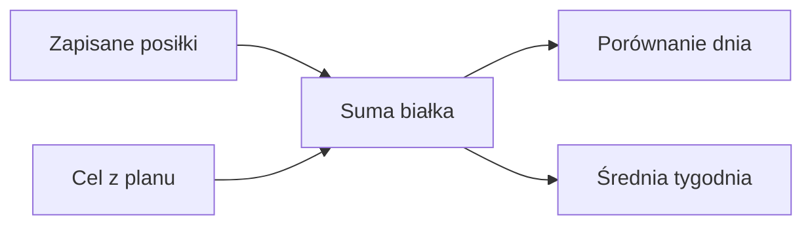

# Białko

## Co to jest

Białko jest jednym ze składników pokazywanych w dzienniku. W planie QBota ma cel 160 g dziennie. Należy do makroskładników ([wyjaśnienie](../slowniczek.md#makroskladniki)).

## Po co

Pomaga sprawdzić, czy zapisane posiłki zbliżają się do przyjętego celu.

## Skąd dane

Gramy białka pochodzą z menu Brokuła i wpisów jedzenia. Wartości dzienne są sumowane w podsumowaniu dnia i tygodnia.

## Jak liczone

Cel na karcie dnia wynosi 160 g. Karta oznacza tę wartość jako „ok” od 90%, czyli od 144 g. W analizie tygodnia ostrzeżenie pojawia się, gdy średnia z zamkniętych dni jest niższa niż 85% celu. Piątkowy plan weekendu w starszej linii wiadomości ma osobną wartość 150 g.

Przykład z bazy: 14.10.2026 dzienny widok danych zawiera 185,1 g białka w zapisanym jedzeniu.

### Przykład krok po kroku

1. Na zrzucie z 18.10.2026 karta pokazuje 148 g białka przy celu 160 g.
2. Różnica wynosi 160 − 148 = 12 g. Karta pokazuje „ok”, bo 148 g przekracza próg 90% × 160 g = 144 g.
3. Późniejszy odczyt tego dnia zawiera 181 g. Wpisy dodane po zrzucie dostarczyły 33,7 g białka, które suma na ekranie zaokrągliła do całych gramów.
4. Wartość „ok” jest etykietą reguły aplikacji, nie oceną medyczną.

Kod rozdziela 150 g w piątkowej wiadomości z planem weekendu i 160 g w normach dnia oraz podsumowaniu. Nie da się ustalić z samych danych, czy ta różnica jest celowa; to jedyna decyzja do potwierdzenia.

## Gdzie to widać

Karta dnia i analiza tygodnia w Zdrowiu, a także wiadomości Trenera.

## Jak czytać

„Ok” na kafelku Brokuła oznacza osiągnięcie 90% celu. To próg prezentacji, a nie osobna norma medyczna.

## Decyzje i historia

W dokumencie Brokuła cel wynosi 160 g; kod moduł planowania potwierdza tę wartość.

## Ograniczenia i pułapki

Suma zależy od jakości danych w menu i szacunków porcji. W tygodniowej analizie białko liczone jest z całego zapisanego jedzenia.

## Wpływa na

Status białka dnia, zalecenia w porannym podsumowaniu i plan weekendu.

## Zależy od

Zapisanych makr posiłków oraz celu z moduł planowania.

## Powiązane hasła

- [Dziennik jedzenia](dziennik.md)
- [Cel kcal](cel-kcal.md)
- [Plan weekendu](weekend.md)

## Jak czytać praktycznie

Jeśli w ciągu dnia widzisz wartość poniżej celu, potraktuj „brakuje” jako różnicę do planu. Na zrzucie z 18.10 różnica to 12 g (160 − 148). Późniejszy odczyt tego dnia pokazał 181 g, czyli o 21 g więcej niż cel. Przyrost wynika z trzech wpisów dodanych po zrzucie.

Przy planie weekendu wartości białka w potrawach są szacunkami. Sprawdź wielkość porcji i etykietę produktu, gdy zależy Ci na dokładnym rachunku. Nie przenoś progu statusu „ok” na indywidualną ocenę zdrowia.

## Co zrobić przy rozbieżności

Wiadomość planu weekendu podaje około 150 g, a karta dnia 160 g. Sprawdź, do którego widoku należy liczba. Nie przedstawiaj niższej wartości jako celu karty dnia.

## Zrodla

- `/opt/qbot/app/qbot_food_plan.py` — `PROTEIN_TARGET`, `norms`.
- `/opt/qbot/app/qbot_food_api.py` — status białka i analiza tygodnia.
- `qbot_v2.albert_day_view` — dane z 14.10.2026.
