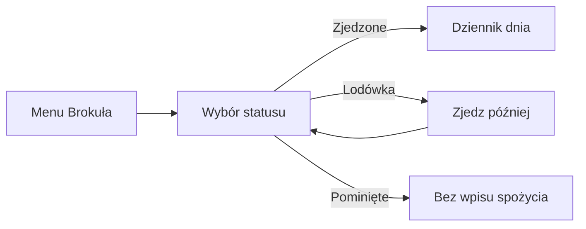

# Brokuł

## Co to jest

Brokuł to źródło planowanych posiłków cateringowych w Zdrowiu. QBot pobiera menu i harmonogram dostaw, a Michał oznacza posiłki jako zjedzone, pominięte albo odłożone.

## Po co

Menu dostarcza składu i wartości posiłków, a status pozwala uwzględnić tylko faktycznie zjedzone pozycje w dzienniku.

## Skąd dane

Importer w import Brokuła i obsługa posiłków Brokuła pobiera dane z konta Brokuła. Posiłki i statusy są przechowywane w posiłkach Brokuła.

## Jak liczone

Do bilansu trafia status zjedzone, przypisany do dnia zjedzenia. Posiłek z lodówki liczy się w dniu, gdy został zjedzony, nie w dniu dostawy. Import wykonuje się co trzy godziny; odczyt sesji może odbywać się częściej.

Przykład z bazy: 23.10.2026 menu zawierało pięć pozycji oczekujące; żadna z nich nie była jeszcze potwierdzona jako zjedzona.

Import menu i jego harmonogram opisano w dokumentacji Brokuła. Potwierdzone pozycje trafiają do dziennika.

## Ograniczenia i pułapki

Import wymaga ważnej sesji Brokuła. Dokumentacja projektu podaje, że menu widoczne w panelu obejmuje pięć dni do przodu. Dane starsze niż dostępna historia menu mogą nie być dostępne w panelu.

## Gdzie to widać

Na stronie Zdrowie, w karcie lub zakładce opisanej w tym haśle. Główne elementy działu i ich położenie pokazuje [przegląd Zdrowia](index.md).

## Jak czytać

Traktuj wynik jako podsumowanie zapisanych danych i reguł QBota. Sprawdź datę, kompletność wpisów i stan potwierdzenia, zanim porównasz go z innym dniem.

## Decyzje i historia

Bieżące działanie opisuje kod; starszy opis projektu może nie obejmować późniejszych zmian. W razie różnicy pierwszeństwo ma działający kod.

## Wpływa na

Dzienny bilans, cel dodatkowego jedzenia i zamknięcie dnia.

## Zależy od

Sesji Brokuła, harmonogramu dostaw i decyzji o statusie każdego posiłku.

## Powiązane hasła

- [Dziennik jedzenia](dziennik.md)
- [Cel kcal](cel-kcal.md)
- [Plan weekendu](weekend.md)

## Jak czytać praktycznie

Gdy posiłek jest zaplanowany, ale jeszcze go nie oznaczyłeś, jego kcal nie powinny być czytane jak potwierdzona suma jedzenia. Wybierz „Zjadłem”, jeśli posiłek został zjedzony; wybierz pominięcie lub lodówkę, jeśli odpowiada to rzeczywistości. Dla pozycji z lodówki dzień dostawy i dzień spożycia mogą być różne.

Na zrzucie w planie weekendu śniadanie ma przycisk „Zjadłem”, a rower jest oznaczony jako usunięty z menu. To przykład stanu interfejsu, nie dowód, że taki sam posiłek będzie w innym tygodniu. Przycisk przywrócenia dotyczy propozycji na ekranie; po przywróceniu sprawdź, czy zgadza się data i plan dnia.

## Zrodla

- `/opt/qbot/app/qbot_brokul.py` — sesja i pobieranie menu.
- `/opt/qbot/app/qbot_brokul_meals.py` — import, statusy i `day_meals`.
- `/opt/qbot/app/docs/BROKUL.md` — „Brokuł”.
- `qbot_v2.brokul_meals` — pozycje menu z 23.10.2026.
