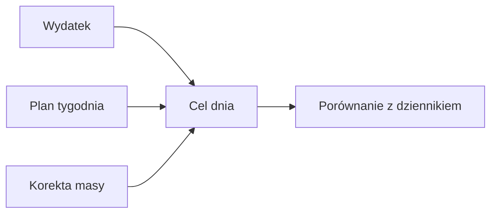

# Cel kcal

## Co to jest

Cel kcal to dzienna ilość energii do zjedzenia, wyliczana dla konkretnego dnia. Uwzględnia szacowane wydatkowanie, korektę na podstawie rozbieżności z wagą oraz planowany bilans.

## Po co

Daje punkt odniesienia dla dziennika i pokazuje, ile energii pozostaje do celu.

## Skąd dane

moduł planowania pobiera wydatek z danych energii i treningów, bierze tygodniowy plan deficytu oraz kalibrację opartą na porównaniu wpisów z trendem ważeń.

## Jak liczone

Kod stosuje: wydatek dnia minus kalibracja plus planowany bilans. Wynik ma dolny limit 1800 kcal. Dla prognozy jest zaokrąglany do 50 kcal; dla dnia z rzeczywistym wydatkiem nie jest zaokrąglany do tej siatki. Dzienny deficyt bierze się z tygodniowego budżetu, który zależy od treningów.

Przykład rzeczywistych danych: 14.10.2026 zapisano 3034 kcal wydatku oraz 2604 kcal przyjęte. Bilans wyniósł −430 kcal. To obserwowany bilans dnia, nie dowód, że dzienny cel był równy 2604 kcal.

### Przykład krok po kroku

1. Dla minionego, kompletnego dnia kod pobiera rzeczywisty zapis wydatku. 14.10.2026 wynosił on 3034 kcal.
2. Odejmowane jest planowane ograniczenie energii. W tygodniowym planie lekkie dni mają domyślnie 300 kcal, a dni treningowe dzielą pozostały budżet z ograniczeniem 300–900 kcal.
3. Jeśli kalibracja z rozbieżności masy jest gotowa, jest odejmowana; jej maksymalna korekta to 500 kcal w każdą stronę.
4. Prognoza zaokrągla cel do 50 kcal i nie schodzi poniżej 1800 kcal. Rzeczywisty miniony wydatek nie przechodzi zaokrąglenia do 50.

Nie wyliczam celu 14.10 wstecz z samego bilansu: cel, kalibracja i plan tygodnia to osobne składniki.

## Gdzie to widać

Karta dnia w Zdrowiu, wykres bilansu i wagi oraz poranna i wieczorna wiadomość QBota.

## Jak czytać

To plan, nie pomiar ani zalecenie medyczne. Brak danych o jedzeniu lub wydatku może ograniczyć porównanie.

## Decyzje i historia

Od 12.10.2026 tydzień pn–nd ma wspólny budżet deficytu. Dzień lekki ma domyślny deficyt 300 kcal, dni z jazdą dzielą pozostały budżet proporcjonalnie do energii treningu, z ograniczeniem do 900 kcal. Choroba wyłącza deficyt.

## Ograniczenia i pułapki

Kalibracja działa dopiero po zebraniu wymaganej liczby zamkniętych dni i ważeń. Wartości wydatku są zależne od dostępności danych Garmina i aktywności.

## Wpływa na

Dokładkę do posiłków Brokuła, paliwo rowerowe i podsumowanie jedzenia w Trenerze.

## Zależy od

Wydatku energii, planu treningów, tygodniowego celu oraz wiarygodności wpisów i ważeń.

## Powiązane hasła

- [Dziennik jedzenia](dziennik.md)
- [Białko](bialko.md)
- [Paliwo na rower](paliwo-rower.md)
- [Bilans i waga Trenera](../trener/bilans-waga.md)

## Jak czytać praktycznie

Jeśli rano widzisz „plan deficytu”, porównaj go z pozostałymi dniami tygodnia, a nie tylko z jednym dniem. Kod układa budżet od poniedziałku do niedzieli. Jazda może dostać większą część budżetu; dzień bez dłuższej jazdy ma domyślny plan −300 kcal. W dniu choroby planowany deficyt wynosi zero i nie jest przenoszony na inne dni.

W kaflu tygodnia wartości „plan” i „było” oznaczają różne rzeczy: planowany bilans oraz wykonany bilans dla dostępnych zamkniętych dni. W zrzucie z 18.10 każdy kafel ma datę, plan i wartość „było” albo stan „przed nami”. Zwróć uwagę, ile dni rzeczywiście jest zamkniętych przed oceną tygodnia.

## Zrodla

- `/opt/qbot/app/qbot_food_plan.py` — `target_for`, `day_plan`, `day_deficit`.
- `/opt/qbot/app/docs/BROKUL.md` — „Cel dnia, dokładka, weekend”.
- `qbot_v2.albert_day_view` — dane z 14.10.2026.
