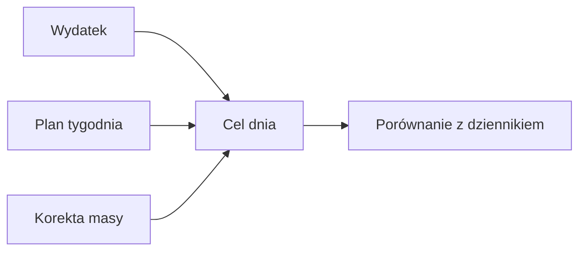
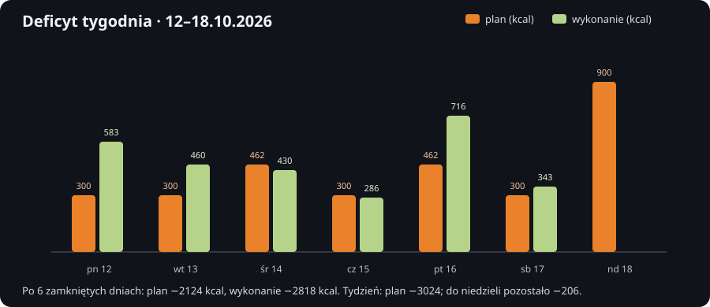
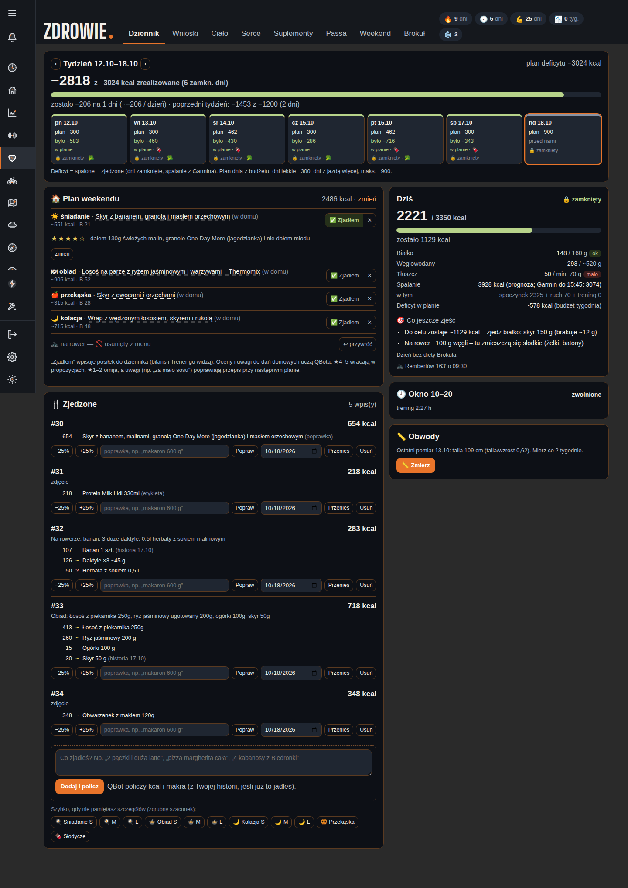

# Cel kcal

## Co to jest

Cel kcal (kilokalorii; [wyjaśnienie](../slowniczek.md#zdrowie-i-jedzenie)) to dzienna ilość energii do zjedzenia, wyliczana dla konkretnego dnia. Uwzględnia szacowane wydatkowanie, korektę na podstawie rozbieżności z wagą oraz planowany bilans.

## Po co

Daje punkt odniesienia dla dziennika i pokazuje, ile energii pozostaje do celu.

## Skąd dane

moduł planowania pobiera wydatek z danych energii i treningów, bierze tygodniowy plan deficytu oraz kalibrację opartą na porównaniu wpisów z trendem ważeń.

## Jak liczone

Wynik ma dolny limit 1800 kcal. Cel dla prognozowanego wydatku jest zaokrąglany do 50 kcal; dla dnia z rzeczywistym wydatkiem nie używa tego zaokrąglenia. Dzienny deficyt bierze się z tygodniowego budżetu zależnego od treningów.

Wzór

Cel dnia = wydatek − kalibracja + planowany bilans. Prognozowany cel zaokrągla się do 50 kcal; cel nie spada poniżej 1800 kcal.

Na zrzucie z 18.10.2026 plan dnia pokazuje deficyt 578 kcal, prognozowany wydatek 3928 kcal i cel 3350 kcal. Późniejszy odczyt o 20:45 pokazuje prognozę 3977 kcal i cel 3400 kcal. Prognoza wydatku wzrosła o 49 kcal; zaokrąglenie celu do 50 kcal przesunęło go o 50 kcal. To zmiana prognozy w ciągu dnia.

### Przykład krok po kroku

1. Tydzień 12–18.10.2026 ma w planie 3024 kcal deficytu.
2. Na zrzucie widać dzienne plany: 300, 300, 462, 300, 462, 300 i 900 kcal. Suma to 3024 kcal.
3. Sześć zamkniętych dni ma wykonany deficyt 583, 460, 430, 286, 716 i 343 kcal. Suma: 2818 kcal.
4. Do niedzielnego planu pozostało 3024 − 2818 = 206 kcal. Dzienny cel i wykonany deficyt są różnymi liczbami; plan zależy od pozostałego budżetu tygodnia.

Nie wyliczam celu 14.10 wstecz z samego bilansu: cel, kalibracja i plan tygodnia to osobne składniki.

## Gdzie to widać

Karta dnia w Zdrowiu, wykres bilansu i wagi oraz poranna i wieczorna wiadomość QBota.

## Jak czytać

To plan, nie pomiar ani zalecenie medyczne. Brak danych o jedzeniu lub wydatku może ograniczyć porównanie.

## Decyzje i historia

Od 12.10.2026 tydzień pn–nd ma wspólny budżet deficytu. Dzień lekki ma domyślny deficyt 300 kcal, dni z jazdą dzielą pozostały budżet proporcjonalnie do energii treningu, z ograniczeniem do 900 kcal. Choroba wyłącza deficyt.

## Ograniczenia i pułapki

Kalibracja działa dopiero po zebraniu wymaganej liczby zamkniętych dni i ważeń. Wartości wydatku są zależne od dostępności danych Garmina i aktywności.

## Wpływa na

Dokładkę do posiłków Brokuła, paliwo rowerowe i podsumowanie jedzenia w Trenerze.

## Zależy od

Wydatku energii, planu treningów, tygodniowego celu oraz wiarygodności wpisów i ważeń.

## Powiązane hasła

- [Dziennik jedzenia](dziennik.md)
- [Białko](bialko.md)
- [Paliwo na rower](paliwo-rower.md)
- [Bilans i waga Trenera](../trener/bilans-waga.md)

## Jak czytać praktycznie

Jeśli rano widzisz „plan deficytu”, porównaj go z całym tygodniem od poniedziałku do niedzieli. Zrzut z 12–18.10.2026 pokazuje budżet −3024 kcal, wykonane −2818 kcal po sześciu zamkniętych dniach i −206 kcal pozostałe na niedzielę. Dzień z jazdą może mieć większy udział niż lekki dzień. Choroba wyłącza planowany deficyt dla danego dnia.

W kaflu tygodnia wartości „plan” i „było” oznaczają różne rzeczy: planowany bilans oraz wykonany bilans dla dostępnych zamkniętych dni. W zrzucie z 18.10 każdy kafel ma datę, plan i wartość „było” albo stan „przed nami”. Zwróć uwagę, ile dni rzeczywiście jest zamkniętych przed oceną tygodnia.

## Zrodla

- `/opt/qbot/app/qbot_food_plan.py` — `target_for`, `day_plan`, `day_deficit`.
- `/opt/qbot/app/docs/BROKUL.md` — „Cel dnia, dokładka, weekend”.
- `qbot_v2.albert_day_view` — dane z 14.10.2026.
- `img/zdrowie-deficyt-20261012-18.svg` — wartości zrzutu tygodnia 12–18.10.2026.
