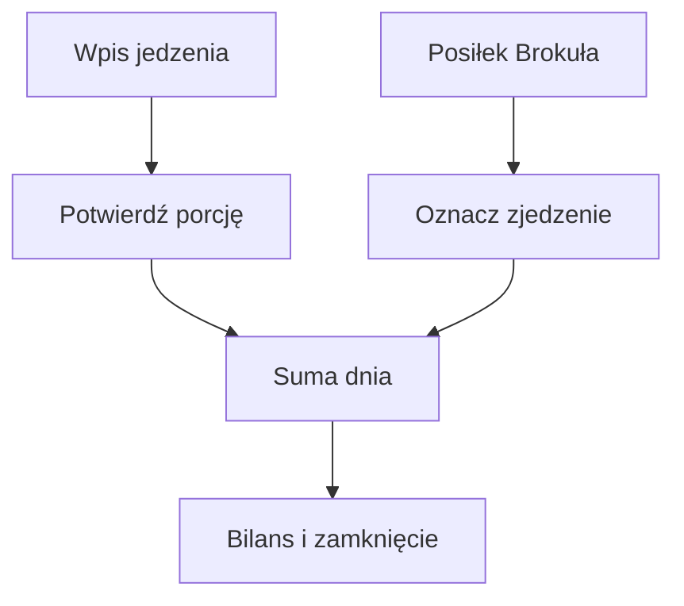

# Dziennik jedzenia

## Co to jest

Dziennik łączy posiłki z menu Brokuła oraz jedzenie wpisane przez Michała. Wpisy mogą być ręcznie poprawiane, a pozycje z oszacowaną porcją są oznaczone jako szacunek.

## Po co

Pomaga zobaczyć, ile jedzenia zapisano danego dnia, porównać wynik z celem i sprawdzić, czy dzień jest zamknięty.

## Skąd dane

Strona Zdrowie przyjmuje wpisy i pozycje menu Brokuła. Telegram przyjmuje tekst i zdjęcia jedzenia.

## Jak liczone

Tekst najpierw trafia do dziennika jako pozycja do rozpoznania. QBot sprawdza podobne wpisy w katalogu i historii, a w pozostałych przypadkach prosi model AI o kcal i pełne makra. Niejasna porcja wymaga wyboru. Dzień z Brokułem zamyka się, gdy nie ma niepotwierdzonych posiłków i Michał potwierdził jedzenie spoza diety albo wpisał co najmniej jeden taki posiłek.

Przykład z 18.10.2026: na zrzucie widać wpisy #30–#34 o wartościach 654, 218, 283, 718 i 348 kcal (kilokalorii; [wyjaśnienie](../slowniczek.md#zdrowie-i-jedzenie)). Ich suma to 2221 kcal. Późniejszy odczyt strony zawiera trzy nowe wpisy z 18:56, 20:02 i 20:18, o łącznej wartości 961 kcal; nowa suma wynosi 3182 kcal. Poszczególne wpisy i ich godziny są widoczne w historii.

### Przykład krok po kroku

1. Ustal dzień wpisu: wszystkie wymienione pozycje należą do 18.10.2026.
2. Dodaj pięć pozycji widocznych na zrzucie: 654 + 218 + 283 + 718 + 348 = 2221 kcal.
3. Dodaj późniejsze wpisy z tego dnia: 715 + 120 + 126 = 961 kcal.
4. Późniejsza suma wynosi 2221 + 961 = 3182 kcal. To aktualizacja zapisu z jednego dnia, a nie rozbieżność w dodawaniu.

Przykład wpisu #32 z tego samego dnia składał się z banana 107 kcal, daktyli 126 kcal i herbaty z sokiem 50 kcal. Suma pozycji to 283 kcal. Przy poszczególnych składnikach ekran pokazuje, które wartości pochodzą z historii, a które są oszacowaniem.

Starsza dokumentacja wspomina osobne przypomnienie 21:30. Bieżący kod dołącza plan weekendu do porannej wiadomości. Wartości szacowane mogą zmienić się po poprawieniu porcji.

## Gdzie to widać

Na stronie Zdrowie, w karcie „Zjedzone” i w podsumowaniu „Dziś”. Na zrzucie z 18.10.2026 pozycje #30–#34 sumują się do 2221 kcal; pod każdym wpisem widać jego skład lub nazwę, a przyciskami można go poprawić, przenieść albo usunąć.

## Jak czytać

Traktuj wynik jako podsumowanie zapisanych danych i reguł QBota. Sprawdź datę, kompletność wpisów i stan potwierdzenia, zanim porównasz go z innym dniem.

## Decyzje i historia

Bieżące działanie opisuje kod; starszy opis projektu może nie obejmować późniejszych zmian. W razie różnicy pierwszeństwo ma działający kod.

## Wpływa na

Bilans dnia, ocenę celu kcal, tygodniowe podsumowania oraz część raportu Trenera.

## Zależy od

Wpisów na stronie lub w Telegramie, importu menu Brokuła i danych o wydatku energii.

## Powiązane hasła

- [Brokuł](brokul.md)
- [Cel kcal](cel-kcal.md)
- [Passa](passa.md)

## Zrodla

- `/opt/qbot/app/qbot_food_log.py` — obsługa wpisów i `close_state`.
- `/opt/qbot/app/qbot_food_api.py` — `day_card`, API `/days`.
- `/opt/qbot/app/docs/BROKUL.md` — „Jedzenie spoza diety”, „Wiadomość dnia”.
- `qbot_v2.albert_day_view` — przykład z 14.10.2026.
