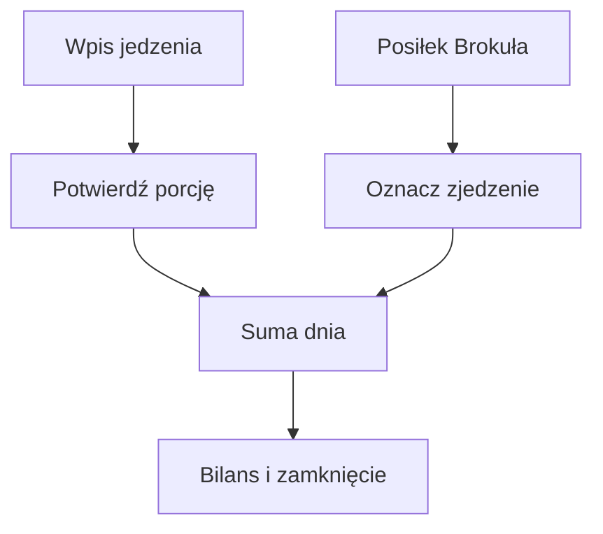

# Dziennik jedzenia

## Co to jest

Dziennik łączy posiłki z menu Brokuła oraz jedzenie wpisane przez Michała. Wpisy mogą być ręcznie poprawiane, a pozycje z oszacowaną porcją są oznaczone jako szacunek.

## Po co

Pomaga zobaczyć, ile jedzenia zapisano danego dnia, porównać wynik z celem i sprawdzić, czy dzień jest zamknięty.

## Skąd dane

Strona Zdrowie przyjmuje wpisy i pozycje menu Brokuła. Telegram przyjmuje tekst i zdjęcia jedzenia.

## Jak liczone

Tekst najpierw trafia do dziennika jako pozycja do rozpoznania. QBot sprawdza podobne wpisy w katalogu i historii, a w pozostałych przypadkach prosi model AI o kcal i pełne makra. Niejasna porcja wymaga wyboru. Dzień z Brokułem zamyka się, gdy nie ma niepotwierdzonych posiłków i Michał potwierdził jedzenie spoza diety albo wpisał co najmniej jeden taki posiłek.

Przykład z bazy: 14.10.2026 dzienny widok danych podawał 2604 kcal i 185,1 g białka; wydatek wynosił 3034 kcal, a bilans −430 kcal. To suma zapisu tego dnia, nie niezależny pomiar.

Starsza dokumentacja wspomina osobne przypomnienie 21:30. Bieżący kod dołącza plan weekendu do porannej wiadomości. Wartości szacowane mogą zmienić się po poprawieniu porcji.

## Gdzie to widać

Na stronie Zdrowie, w karcie lub zakładce opisanej w tym haśle. Główne elementy działu i ich położenie pokazuje [przegląd Zdrowia](index.md).

## Jak czytać

Traktuj wynik jako podsumowanie zapisanych danych i reguł QBota. Sprawdź datę, kompletność wpisów i stan potwierdzenia, zanim porównasz go z innym dniem.

## Decyzje i historia

Bieżące działanie opisuje kod; starszy opis projektu może nie obejmować późniejszych zmian. W razie różnicy pierwszeństwo ma działający kod.

## Wpływa na

Bilans dnia, ocenę celu kcal, tygodniowe podsumowania oraz część raportu Trenera.

## Zależy od

Wpisów na stronie lub w Telegramie, importu menu Brokuła i danych o wydatku energii.

## Powiązane hasła

- [Brokuł](brokul.md)
- [Cel kcal](cel-kcal.md)
- [Passa](passa.md)

## Zrodla

- `/opt/qbot/app/qbot_food_log.py` — obsługa wpisów i `close_state`.
- `/opt/qbot/app/qbot_food_api.py` — `day_card`, API `/days`.
- `/opt/qbot/app/docs/BROKUL.md` — „Jedzenie spoza diety”, „Wiadomość dnia”.
- `qbot_v2.albert_day_view` — przykład z 14.10.2026.
