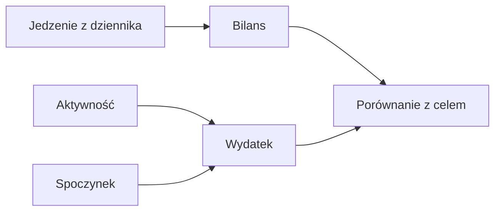

# Energia

## Co to jest

Energia w Zdrowiu oznacza energię przyjętą z jedzenia, energię wydatkowaną oraz różnicę między nimi.

## Po co

Pomaga porównać dziennik jedzenia z szacowanym wydatkiem i celem kcal.

## Skąd dane

Widok Zdrowia pokazuje energię aktywną, spoczynkową, całkowitą, przyjętą i bilans. Zapis jedzenia pochodzi z dziennika.

## Jak liczone

Wydatek całkowity to energia aktywna plus spoczynkowa. Bilans to energia przyjęta minus wydatek. Przykład z 14.10.2026: 2604 kcal przyjęte − 3034 kcal wydatkowane = −430 kcal.

Dokumentacja opisuje źródła; aktualne wyliczenia potwierdzono w kodzie i bazie.

## Ograniczenia i pułapki

Energia z urządzenia jest szacunkiem. Nie utożsamiaj bilansu z pomiarem zmiany masy z jednego dnia.

## Gdzie to widać

Na stronie Zdrowie, w karcie lub zakładce opisanej w tym haśle. Główne elementy działu i ich położenie pokazuje [przegląd Zdrowia](index.md).

## Jak czytać

Traktuj wynik jako podsumowanie zapisanych danych i reguł QBota. Sprawdź datę, kompletność wpisów i stan potwierdzenia, zanim porównasz go z innym dniem.

## Decyzje i historia

Bieżące działanie opisuje kod; starszy opis projektu może nie obejmować późniejszych zmian. W razie różnicy pierwszeństwo ma działający kod.

## Wpływa na

Cel kcal, podsumowanie jedzenia i bilans Trenera.

## Zależy od

Zapisów jedzenia, danych aktywnych i spoczynkowych.

## Powiązane hasła

- [Dziennik jedzenia](dziennik.md)
- [Cel kcal](cel-kcal.md)
- [Masa ciała](masa-ciala.md)

## Jak czytać praktycznie

Jeśli po południu pasek pokazuje, że dużo kcal „zostało”, sprawdź godzinę aktualizacji spalania oraz kompletność dziennika. Podczas trwającego dnia system może łączyć pomiar do tej chwili z prognozą reszty doby. Dzień zamknięty i kompletny jest lepszy do porównywania z innymi dniami.

Dla pełnych dni z 14–17.10.2026 wykres poniżej zestawia sumę jedzenia i całkowity wydatek. 16.10 zapisane 2736 kcal zestawiono z wydatkiem 3452 kcal; różnica wynosi −716 kcal. To pokazuje różnicę dwóch zapisów, ale nie pozwala przewidzieć zmiany masy następnego ranka. Woda, pora ważenia i zawartość przewodu pokarmowego zmieniają pojedynczy pomiar.

## Ograniczenie przykładu

Wykres pokazuje cztery dni z kompletnym statusem energii. Nie pokazuje 18.10, bo odczyt tego dnia miał status częściowy. Dla dnia częściowego nie porównuję słupka z pełnym dniem. Niezależnie od statusu, suma jedzenia może być niepełna, jeżeli wpisy nie zostały uzupełnione.

## Zrodla

- `/opt/qbot/app/docs/PROJEKT_ODZYWIANIE.md` — `_build_nutrition_data`, pola energii.
- `/opt/qbot/app/qbot_food_api.py` — `/balance`, `/days`.
- `qbot_v2.albert_day_view` — dane z 14.10.2026.
