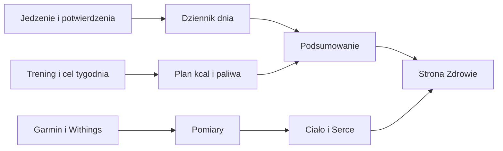

# Zdrowie i jedzenie

## Co to jest

To miejsce do przeglądu jedzenia, planu energii, ciała i pomiarów zdrowotnych. Część liczb pochodzi z urządzeń, część z wpisów Michała, a plan posiłków i cele są wyliczeniami QBota.

## Po co

Rano można sprawdzić plan dnia, po posiłku uzupełnić dziennik, a wieczorem zobaczyć podsumowanie. Karty Serce i Ciało pomagają zebrać historię do własnego przeglądu lub rozmowy z lekarzem. Wynik aplikacji nie jest diagnozą.

## Skąd dane

Dziennik przyjmuje wpisy ręczne i posiłki z Brokuła. Energia i część pomiarów ciała przychodzi z Garmina lub Withings. Sen pochodzi z Garmina. Potwierdzenia posiłków, okna i suplementów wymagają działania użytkownika. Plan dnia uwzględnia planowany trening oraz tygodniowy cel.

## Droga przez dział

## Jak przejść przez dzień

1. Otwórz kartę **Dziś**. Sprawdź cel kcal, białko, plan jedzenia i trening. To plan/stan na moment odczytu, nie obietnica dokładnego wydatku.
2. Po jedzeniu naciśnij „Zjadłem” przy posiłku albo dopisz pozycję. Wpisy z niepewną porcją mogą być szacowane i można je poprawić.
3. Zamknij dzień, gdy wpisy są kompletne. Samo przekroczenie celu nie przekreśla licznika regularności.
4. W kolejnych kartach sprawdź tydzień, ciało, Serce, suplementy i Passę według potrzeb.

Przykład z bazy za 14.10.2026: zapisano 2604 kcal jedzenia, 185,1 g białka i wydatek 3034 kcal. Rachunek bilansu: 2604 − 3034 = −430 kcal. Są to zapisane/wyliczone dane jednego dnia, nie pomiar zmiany masy.

## Gdzie to widać

Główny ekran ma górny pasek zakładek, tygodniowy pasek planu, plan weekendu, kartę „Dziś” i listę „Zjedzone”. Na dostarczonym zrzucie z 18.10.2026 widać również „Okno 10–20”, „Obwody” i liczniki w nagłówku. Obraz pokazuje konkretny stan tego ekranu, a nie zawsze aktualne dane:

| Co widać na ekranie | Hasło |
|---|---|
| Tydzień, plan deficytu i kafle dni | [Cel kcal](cel-kcal.md) |
| Plan weekendu i przyciski „Zjadłem” | [Plan weekendu](weekend.md), [Brokuł](brokul.md) |
| Kcal, białko, węglowodany i tłuszcz | [Energia](energia.md), [Białko](bialko.md), [Dziennik](dziennik.md) |
| Spalone kcal i pozostałe kcal | [Energia](energia.md), [Cel kcal](cel-kcal.md) |
| „Co jeszcze zjeść” | [Białko](bialko.md), [Paliwo na rower](paliwo-rower.md) |
| Okno 10–20 | [Okno 10–20](okno-10-20.md) |
| Obwody i pomiar talii | [Obwody](obwody.md) |
| Lista zjedzonych wpisów i korekty | [Dziennik](dziennik.md) |
| Passy w nagłówku | [Passa](passa.md) |
| Zakładki Ciało, Serce i Suplementy | [Masa ciała](masa-ciala.md), [Serce](serce.md), [Suplementy](suplementy.md) |
| Sen | [Sen](sen.md) |

## Jak czytać

Zielony pasek w tygodniu pokazuje postęp wobec planu; wynik i etykiety należy czytać razem z zamkniętymi dniami. Wpis „przed nami” nie jest spożyciem. „Zostało” porównuje dzienny cel z dotychczasowym zapisem. Energia z urządzenia jest szacunkiem, a jedzenie bez wpisu nie jest uwzględnione.

Zrzut pokazuje 18.10.2026 między innymi 1155/3100 kcal i 70/160 g białka. Odczyt późniejszy z bazy dla tego dnia daje 1873 kcal i 136,7 g białka; dzienna energia urządzenia ma status częściowy. To różne chwile/stany i nie wolno traktować zrzutu jako aktualnego odczytu.

## Ograniczenia i pułapki

Zrzut ekranu jest automatycznym ujęciem jednej chwili. Widoczne w nim dane mogą być starsze od aktualnej bazy. Część dziennych celów jest prognozą, a część zamkniętego dnia może bazować na danych rzeczywistych. Tętno, ciśnienie, skład ciała i sen z urządzeń wymagają ostrożnej interpretacji.

## Wpływa na / Zależy od

- Dziennik zasila bilans, ocenę celu, Passę i część raportu Trenera.
- Plan kcal i paliwo zależą od danych energii, planu treningów i celu tygodnia.
- Karty Serce, Sen, Ciało i Suplementy zależą od pomiarów lub potwierdzeń.

## Powiązane hasła

- [Forma i Wellness](../forma/index.md)
- [Trener](../trener/index.md)
- [Połączenia Garmin i Withings](../polaczenia/index.md)

## Zrodla

- `/opt/qbot/app/qbot_food_api.py` — `day_card`, `analysis`, `week_analysis`, `body_comp`, `circ_get`.
- `/opt/qbot/app/qbot_food_plan.py` — `day_plan`, `expend`, `week_deficits`.
- `/opt/qbot/app/qbot_heart.py` — reguły karty zdrowia.
- `qbot_v2.intake_logs`, `qbot_v2.intake_items`, `qbot_v2.energy_daily`, `qbot_v2.body_circumference` — odczyty z 14–18.10.2026.
- `img/ekrany/zdrowie.png` — zrzut ekranu z 18.10.2026.
