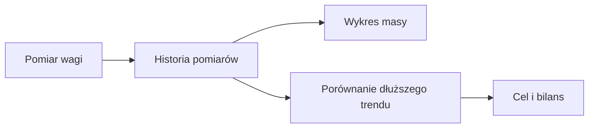

# Masa ciała

## Co to jest

Masa ciała to zapis pomiarów z wagi, pokazywany obok bilansu energii i składu ciała.

## Po co

Pomaga obserwować zmianę w czasie i sprawdzać, czy długoterminowy trend jest zgodny z planem.

## Skąd dane

Aktualna seria dzienna jest udostępniana przez dziennej serii masy. Rzeczywiste pomiary i skład ciała pochodzą z rzeczywistych pomiarach oraz widoków kompozycji; pomiary wagi są importowane z Garmin Index Scale.

## Jak liczone

Wykres pokazuje serię masy i może zestawiać ją z celem. Porównanie jedzenia z wagą używa rzeczywistych pomiarów, ponieważ dzienna seria może powtarzać ostatnią wagę na kolejnych dniach.

Dzienna seria może powtarzać ostatni znany pomiar. Nie należy traktować każdego dnia jako nowego ważenia.

## Gdzie to widać

Na stronie Zdrowie, w karcie lub zakładce opisanej w tym haśle. Główne elementy działu i ich położenie pokazuje [przegląd Zdrowia](index.md).

## Jak czytać

Traktuj wynik jako podsumowanie zapisanych danych i reguł QBota. Sprawdź datę, kompletność wpisów i stan potwierdzenia, zanim porównasz go z innym dniem.

## Decyzje i historia

Bieżące działanie opisuje kod; starszy opis projektu może nie obejmować późniejszych zmian. W razie różnicy pierwszeństwo ma działający kod.

## Wpływa na

Wykres ciała, trend celu i kalibrację bilansu jedzenia.

## Zależy od

Synchronizacji pomiarów wagi oraz dostępności historii w bazie.

## Powiązane hasła

- [Energia](energia.md)
- [Bilans i waga Trenera](../trener/bilans-waga.md)
- [Połączenia](../polaczenia/index.md)

## Jak czytać praktycznie

Jeśli waga wzrosła po jednym dniu, nie zmieniaj planu wyłącznie na podstawie tego pomiaru. Sprawdź serię dłuższą niż kilka dni i porównuj odczyty wykonane o podobnej porze. Wskaźniki składu ciała z wagi także są szacunkami urządzenia.

### Przykład krok po kroku

1. 14.10.2026 pomiar wynosił 103,65 kg.
2. 16.10.2026 wynosił 102,92 kg. Różnica to 102,92 − 103,65 = −0,73 kg.
3. 18.10.2026 wynosił 103,04 kg. Różnica względem 16.10 to 103,04 − 102,92 = +0,12 kg.
4. Trzy pomiary w krótkim okresie pokazują wahania, a nie tempo redukcji. Waga nie mierzy zmiany tkanki tłuszczowej z dokładnością do setnych kilograma.

Przy zmianie trybu pomiaru składu ciała 12.10.2026 procent tłuszczu przed i po tej dacie może nie być porównywalny wprost.

## Co sprawdzić przy zmianie

Jeśli wykres gwałtownie skacze, sprawdź datę i źródło pomiaru. Wartość dzienna może przenosić ostatnią znaną wagę, dlatego nie każdy punkt szeregu oznacza nowe wejście na wagę. Rzeczywiste pomiary są podstawą porównań opisanych w tej karcie. Dla krótkiego zakresu dat podaję wyłącznie odczytane punkty, bez wyliczania trendu.

## Zrodla

- `/opt/qbot/app/docs/PROJEKT_ODZYWIANIE.md` — źródła masy i składu ciała.
- `/opt/qbot/app/docs/BROKUL.md` — różnica między trendem dziennym a rzeczywistymi ważeniami.
- `qbot_v2.fitmodel_daily`, `qbot_v2.body_measurements`.
