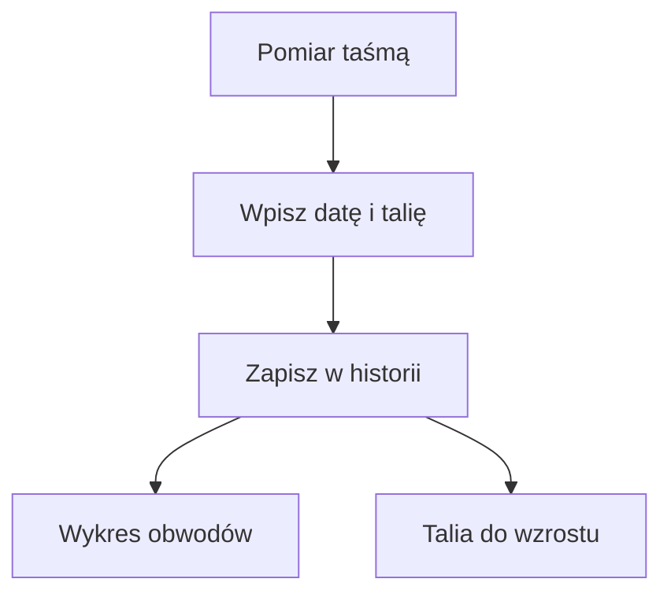

# Obwody ciała

## Co to jest

Obwody to ręcznie wpisywane pomiary talii, bioder, klatki piersiowej, uda, ramienia i szyi. Wykres pozwala porównywać zapisane pomiary w czasie.

## Po co

Jeśli masa z wagi zmienia się z dnia na dzień, pomiar talii w odstępach czasu daje dodatkowy punkt odniesienia. W karcie Serce talia oraz relacja talii do wzrostu są używane jako sygnały w podsumowaniu.

## Skąd dane

Pomiary wpisuje się ręcznie w karcie „Obwody”. Wartość talii jest wymagana, pozostałe pola są opcjonalne. Wpis można poprawić dla danego dnia. Widok danych udostępnia historię do 1500 dni.

## Jak liczone

1. Wybierz dzień pomiaru i wpisz obwód w centymetrach. Kod przyjmuje wartości od 15 do 250 cm.
2. Wpisz co najmniej talię; pozostałe wymiary można zostawić puste.
3. Zapisz. Jeśli istnieje już pomiar z tego dnia, nowy zapis go zastępuje.
4. Porównuj pomiary z podobnych warunków. W karcie Serce talia/wzrost jest obliczana z wysokością 177 cm. Przykład danych z 13.10.2026: talia 109 cm, więc 109 ÷ 177 = 0,616, pokazywane po zaokrągleniu jako 0,62.

Wzór

Talia/wzrost = obwód talii w cm ÷ wzrost w cm. Dla danych z 13.10.2026: 109 ÷ 177 = 0,6158, czyli 0,62 po zaokrągleniu do dwóch miejsc.

## Gdzie to widać

Na zrzucie ekranu z 18.10.2026 karta „Obwody” znajduje się po prawej stronie, pod kartą „Okno 10–20”. Tekst wskazuje ostatni pomiar: 13.10, talia 109 cm i talia/wzrost 0,62. Przycisk „Zmierz” prowadzi do wpisu pomiaru.

## Jak czytać

Kod karty Serce oznacza talię od 94 cm lub talia/wzrost od 0,50 jako ostrzeżenie, a talię od 102 cm lub relację od 0,60 jako mocniejszy sygnał. To progi wyświetlane przez QBot, a nie diagnoza. Pojedynczy centymetr ani różnica między dwoma pomiarami nie przesądza o zmianie zdrowia.

## Ograniczenia i pułapki

Baza potwierdza jeden zapis obwodów: 13.10.2026. Zrzut pokazuje ten sam wynik. Nie ma więc podstaw do opisania rzeczywistego trendu ani tempa zmiany. Dokładne wskazówki pomiaru taśmą nie zostały potwierdzone w kodzie.

> DO SPRAWDZENIA: instrukcja pomiaru taśmą na stronie i ewentualne dodatkowe reguły prezentacji wykresu obwodów.

## Wpływa na

Karta Ciała oraz część sygnałów w karcie Serce i raporcie dla lekarza.

## Zależy od

Ręcznego pomiaru i wpisania daty. Wartość relacji talii do wzrostu zależy od ustawionego wzrostu używanego przez kartę.

## Powiązane hasła

- [Masa ciała](masa-ciala.md)
- [Serce](serce.md)
- [Energia](energia.md)

## Co sprawdzić przy pomiarze

Zapisz dzień, w którym wykonałeś pomiar, i nie porównuj wpisu wykonanego po długiej przerwie z przypadkowym pomiarem następnego dnia jako pewnej zmiany ciała. Wartości są podawane w centymetrach. System waliduje zakres liczbowy, ale nie ocenia, czy taśma była ułożona w tym samym miejscu. Baza ma obecnie tylko jeden potwierdzony dzień, więc następny pomiar będzie dopiero drugim punktem do porównania.

## Zrodla

- `/opt/qbot/app/qbot_food_api.py` — endpointy `/circ` i `/body`, walidacja oraz zapis.
- `/opt/qbot/app/qbot_heart.py` — `body_status`, progi talii i talia/wzrost.
- `qbot_v2.body_circumference` — pomiar z 13.10.2026.
- `img/ekrany/zdrowie.png` — karta Obwody.
