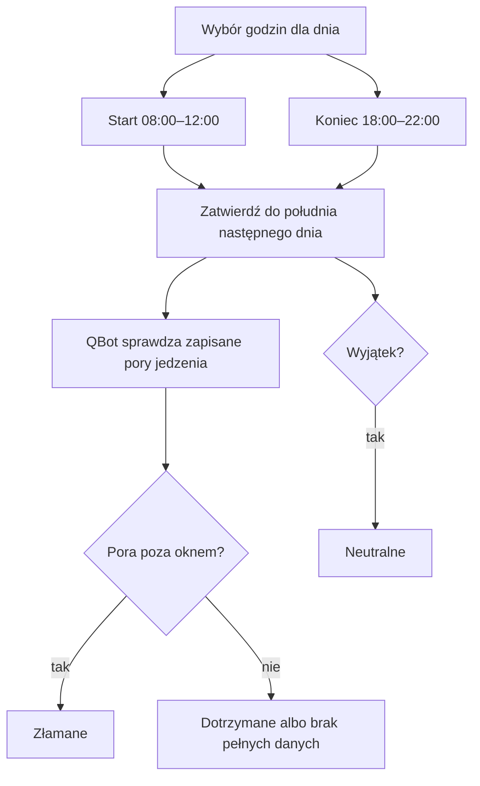

# Okno 10–20

## Co to jest

Okno żywieniowe to przedział godzin jedzenia dla danego dnia. Domyślnie trwa od 10:00 do 20:00. Dla konkretnego dnia można przesunąć początek i koniec w dozwolonym zakresie.

## Po co

Pozwala zapisać, czy Michał dotrzymał ustalonych godzin, bez automatycznego oceniania samej ilości kalorii.

## Skąd dane

W Zdrowiu wybierasz początek i koniec suwakami, a następnie naciskasz jeden przycisk „Zatwierdź”. Zatwierdzenie zapisuje godziny i potwierdzenie dnia. QBot sprawdza pory zapisanych posiłków; wiadomości w Telegramie mają też przycisk potwierdzenia okna.

## Jak liczone

1. Dzień zaczyna się z domyślnym oknem 10:00–20:00, jeśli nie wybrano innych godzin.
2. Możesz przesunąć początek między 08:00 a 12:00, a koniec między 18:00 a 22:00. Suwak zmienia godzinę skokami co 15 minut.
3. Naciśnięcie „Zatwierdź” zapisuje wybrane godziny i potwierdza dzień. Możesz zatwierdzić je do 12:00 następnego dnia.
4. QBot porównuje podane pory zapisanych posiłków z granicami wybranego okna. Posiłek przed początkiem albo o końcu okna i później łamie regułę.
5. Gdy wpis nie ma godziny, QBot nie wylicza z niego naruszenia. Dzień może pozostać potwierdzony mimo brakujących godzin w części wpisów.
6. Wyjątek, na przykład długi trening, może nadać dniowi status neutralny. Neutralny dzień nie jest liczony jako dotrzymane okno.

Dane z bazy z **19.10.2026** pokazują okno **11:00–20:15**, zatwierdzone. Dwa zapisane tego dnia wpisy jedzenia nie miały podanej godziny. Dlatego na podstawie samych tych wpisów nie da się stwierdzić, czy jedzenie mieściło się w przedziale. To przykład ustawienia z bazy, a nie potwierdzenie konkretnych pór posiłków.

Wzór

Długość okna = godzina końca − godzina początku. Dla danych z 19.10.2026: 20:15 − 11:00 = 9 godzin 15 minut. Wpis narusza okno, gdy jego podana pora jest wcześniejsza niż 11:00 albo wynosi 20:15 lub później.

Reguły okna i wyjątki są opisane w dokumentacji oraz sprawdzone w bieżącym kodzie.

## Ograniczenia i pułapki

Kontrola naruszeń działa tylko dla wpisów z podaną porą. Nie należy dopisywać fikcyjnej godziny do później zarejestrowanego posiłku. Ręczne potwierdzenie po terminie może być oznaczone jako spóźnione. Wybrane godziny nie zmieniają godzin zapisanych posiłków. Długość treningu pochodzi z zapisu aktywności; karta dnia może pokazywać długość sesji z Kalendarza.

## Gdzie to widać

Na stronie Zdrowie, w karcie lub zakładce opisanej w tym haśle. Główne elementy działu i ich położenie pokazuje [przegląd Zdrowia](index.md).

## Jak czytać

Traktuj wynik jako podsumowanie zapisanych danych i reguł QBota. Sprawdź datę, kompletność wpisów i stan potwierdzenia, zanim porównasz go z innym dniem.

## Decyzje i historia

19.10.2026: okno można dopasować osobno dla dnia. Suwaki pozwalają wybrać początek 08:00–12:00 i koniec 18:00–22:00 co 15 minut. Jeden przycisk „Zatwierdź” zapisuje godziny i potwierdzenie; stan wylicza QBot z godzin wpisów, o ile zostały zapisane.

## Wpływa na

Licznik okna w Passie i podsumowanie dnia.

## Zależy od

Wpisów z godziną, potwierdzenia Michała, planu treningu i wydarzeń w Kalendarzu.

## Powiązane hasła

- [Dziennik jedzenia](dziennik.md)
- [Passa](passa.md)

## Jak czytać praktycznie

Jeśli karta pyta o wczorajsze okno, wybierz odpowiedź zgodną z własną wiedzą. System może rozpoznać godzinę wpisu, ale wpis bez godziny nie mówi, kiedy posiłek był zjedzony. Potwierdzenie ma termin do 12:00 następnego dnia. Po terminie status może zostać spóźniony i nie zawsze zmieni historyczny licznik tak, jak oczekujesz.

Dzień neutralny nie oznacza „okno dotrzymane”; oznacza, że wyjątek nie zwiększa ani nie przerywa passy. Według kodu wyjątkiem jest między innymi trening od 90 minut oraz wybrane wydarzenia wyjazdowe. Same kalorie z danego dnia nie pozwalają rozstrzygnąć statusu okna.

## Zależność od wpisów

Godzina musi być częścią zapisu, aby reguła mogła ją porównać z granicami okna. Jeżeli zapisujesz posiłek później, nie dopisuj fikcyjnej pory tylko po to, by uzyskać status. Użyj potwierdzenia, jeśli ekran o nie pyta. Dzień neutralny pozostaje odrębny od wyniku pozytywnego.

## Zrodla

- `/opt/qbot/app/qbot_food_streaks.py` — `window_status`, `exempt_reason`, `set_window`.
- `/opt/qbot/app/qbot_food_api.py` — odczyt okna oraz zapis/akceptacja godzin dnia.
- `/opt/qbot/web/public/jedzenie.js` — suwaki i przycisk „Zatwierdź”.
- `/opt/qbot/app/docs/BROKUL.md` — „Pasy, okno żywieniowe”.
