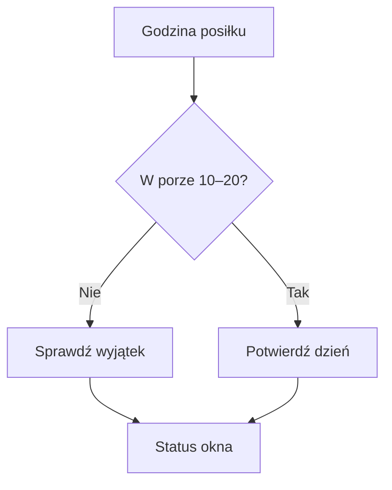

# Okno 10–20

## Co to jest

Okno żywieniowe to zasada zapisana w QBot: jedzenie między 10:00 a 20:00. Przed 10:00 dopuszczona jest czarna kawa.

## Po co

Pozwala zapisać, czy Michał dotrzymał ustalonych godzin, bez automatycznego oceniania samej ilości kalorii.

## Skąd dane

QBot sprawdza potwierdzenie w dniu w dzienniku oraz godzinę wpisu w wpisach jedzenia. Potwierdzenie można zrobić w Zdrowiu lub przyciskiem w Telegramie.

## Jak liczone

Wpis z podaną godziną przed 10:00 lub od 20:00 oznacza złamanie okna. Michał może potwierdzić inny stan przyciskiem. Potwierdzenie jest przyjmowane do 12:00 następnego dnia. Trening co najmniej 90 minut, delegacja, urlop i wydarzenie z „wyprawa” są neutralne.

Reguły okna i wyjątki są opisane w dokumentacji oraz sprawdzone w bieżącym kodzie.

## Ograniczenia i pułapki

Automatyczna kontrola czasu działa tylko, gdy wpis ma podaną porę. Ręczne potwierdzenie może zmienić status, ale po terminie jest oznaczane jako spóźnione.

## Gdzie to widać

Na stronie Zdrowie, w karcie lub zakładce opisanej w tym haśle. Główne elementy działu i ich położenie pokazuje [przegląd Zdrowia](index.md).

## Jak czytać

Traktuj wynik jako podsumowanie zapisanych danych i reguł QBota. Sprawdź datę, kompletność wpisów i stan potwierdzenia, zanim porównasz go z innym dniem.

## Decyzje i historia

Bieżące działanie opisuje kod; starszy opis projektu może nie obejmować późniejszych zmian. W razie różnicy pierwszeństwo ma działający kod.

## Wpływa na

Licznik okna w Passie i podsumowanie dnia.

## Zależy od

Wpisów z godziną, potwierdzenia Michała, planu treningu i wydarzeń w Kalendarzu.

## Powiązane hasła

- [Dziennik jedzenia](dziennik.md)
- [Passa](passa.md)

## Jak czytać praktycznie

Jeśli karta pyta o wczorajsze okno, wybierz odpowiedź zgodną z własną wiedzą. System może rozpoznać godzinę wpisu, ale wpis bez godziny nie mówi, kiedy posiłek był zjedzony. Potwierdzenie ma termin do 12:00 następnego dnia. Po terminie status może zostać spóźniony i nie zawsze zmieni historyczny licznik tak, jak oczekujesz.

Dzień neutralny nie oznacza „okno dotrzymane”; oznacza, że wyjątek nie zwiększa ani nie przerywa passy. Według kodu wyjątkiem jest między innymi trening od 90 minut oraz wybrane wydarzenia wyjazdowe. Same kalorie z danego dnia nie pozwalają rozstrzygnąć statusu okna.

## Zależność od wpisów

Godzina musi być częścią zapisu, aby reguła mogła ją porównać z granicami okna. Jeżeli zapisujesz posiłek później, nie dopisuj fikcyjnej pory tylko po to, by uzyskać status. Użyj potwierdzenia, jeśli ekran o nie pyta. Dzień neutralny pozostaje odrębny od wyniku pozytywnego.

## Zrodla

- `/opt/qbot/app/qbot_food_streaks.py` — `window_status`, `exempt_reason`, `set_window`.
- `/opt/qbot/app/qbot_food_api.py` — endpoint `/window`.
- `/opt/qbot/app/docs/BROKUL.md` — „Pasy, okno żywieniowe”.
