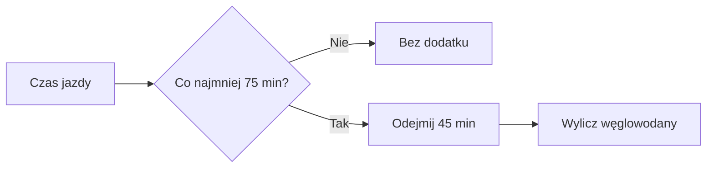

# Paliwo na rower

## Co to jest

To planowana ilość węglowodanów na rower, obliczana dla treningów trwających co najmniej 75 minut.

## Po co

Podpowiada, ile węglowodanów uwzględnić w jedzeniu podczas dłuższej jazdy.

## Skąd dane

Czas i rodzaj treningu pochodzą z planu Trenera oraz zapisanych aktywności. Obliczenie wykonuje reguła planu żywienia.

## Jak liczone

Dla jazdy od 75 minut kod liczy około 50 g węglowodanów na godzinę po pierwszych 45 minutach. Wynik jest zaokrąglany do 10 g. Suma dotyczy treningów rowerowych danego dnia.

Przykład rachunku z reguły: jazda 105 minut daje 50 g/h × (105−45)/60 = 50 g węglowodanów.

### Przykład krok po kroku

1. Sprawdź, czy w planie jest jazda rowerowa trwająca co najmniej 75 minut.
2. Pierwsze 45 minut nie zwiększa tej dokładki.
3. Dla 105 minut zostaje 60 minut: 50 g/h × 60/60 = 50 g węglowodanów.
4. Wynik jest zaokrąglany do 10 g; dla kilku kwalifikujących się jazd wartości są sumowane.

W dziennym zestawieniu 18.10.2026 widnieje jazda 163 min. Weryfikacja długości planu: 163 ≥ 75, czas po pierwszych 45 min to 118 min; obliczenie daje 98,3 g, po zaokrągleniu do 10 g — 100 g. To przykład reguły zastosowanej do czasu pokazanego na zrzucie, nie potwierdzenie faktycznie zjedzonej ilości.

## Gdzie to widać

W karcie dnia, porannym podsumowaniu Trenera i planie weekendu.

## Jak czytać

To ilość zaplanowana na podstawie czasu treningu. Nie jest to pomiar faktycznie zjedzonych węglowodanów.

## Decyzje i historia

Reguła od 12.10.2026: trening co najmniej 75 minut, tempo około 50 g węglowodanów na godzinę po pierwszych 45 minutach.

## Ograniczenia i pułapki

Jeśli czas treningu się zmieni albo plan nie zawiera jazdy, planowana ilość może nie odpowiadać rzeczywistemu wysiłkowi.

## Wpływa na

Podział celu dnia na energię podczas jazdy i jedzenie po treningu.

## Zależy od

Czasu i typu sesji w Trenerze oraz planu jedzenia.

## Powiązane hasła

- [Cel kcal](cel-kcal.md)
- [Plan weekendu](weekend.md)
- [Kalendarz Trenera](../trener/kalendarz.md)

## Jak czytać praktycznie

Jeśli karta sugeruje węglowodany na rower, sprawdź czas zaplanowanej jazdy. Krótsze treningi niż 75 minut nie uruchamiają tej reguły. Wartość dotyczy planu i nie potwierdza, że przekąska została zabrana ani zjedzona.

Na zrzucie z 18.10.2026 widnieje trening 163 min. Po odjęciu pierwszych 45 min zostaje 118 min. Przy 50 g na godzinę daje to 98,3 g, zaokrąglone do 100 g. Jeżeli plan zmieni się w ostatniej chwili, potraktuj tę liczbę jako nieaktualną i sprawdź kartę ponownie. Cel energii i ilość paliwa są osobnymi wskazówkami.

## Granica wyliczenia

Reguła opiera się na zaplanowanej długości sesji rowerowej, a nie na wskazaniu czujnika ani ilości jedzenia w dzienniku. Przy planie krótszym niż 75 min dodatku nie ma. Dla dokładnie 75 min obliczenie po odjęciu 45 min daje 25 g; Python zaokrągla wynik do 20 g. Kiedy plan zawiera więcej niż jedną kwalifikującą się jazdę, wynik sesji jest sumowany.

## Zrodla

- `/opt/qbot/app/qbot_food_plan.py` — `day_plan`, `FUEL_MIN`, `FUEL_G_H`.
- `/opt/qbot/app/docs/BROKUL.md` — „Cel dnia, dokładka, weekend”.
