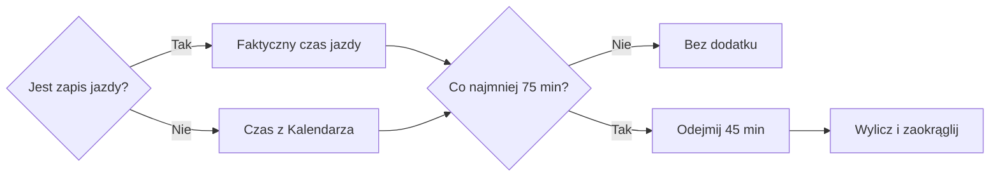
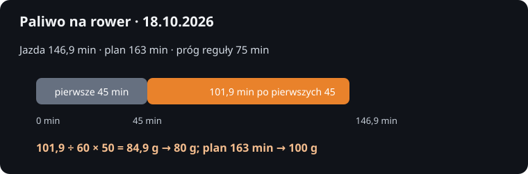

# Paliwo na rower

## Co to jest

To podpowiedź, ile węglowodanów przygotować na rower. Gdy jazda jest już zarejestrowana, obliczenie używa jej faktycznego czasu. Jeśli zapisu jazdy jeszcze nie ma, używa czasu z Kalendarza. Reguła obejmuje jazdy trwające co najmniej 75 minut.

## Po co

Podpowiada, ile węglowodanów uwzględnić w jedzeniu podczas dłuższej jazdy.

## Skąd dane

Czas jazdy pochodzi najpierw z zapisu wykonanej aktywności. Jeżeli nie ma jeszcze jazdy z dodatnim czasem, QBot bierze długość rowerowej sesji z Kalendarza.

## Jak liczone

Dla każdej jazdy od 75 minut kod liczy około 50 g węglowodanów na godzinę po pierwszych 45 minutach. Wynik każdej jazdy jest zaokrąglany do 10 g, a następnie wyniki są sumowane.

Wzór

Paliwo = czas powyżej 45 minut × 50 g na godzinę, zaokrąglone do 10 g. Reguła uruchamia się od treningu trwającego 75 minut.

Przykład rachunku z reguły: jazda 105 minut daje 50 g/h × (105−45)/60 = 50 g węglowodanów.

### Przykład krok po kroku

1. Sprawdź, czy w bazie jest zapis jazdy na dany dzień. Dnia 18.10.2026 zapis jazdy wynosił 8 815 sekund, czyli 146,9 min. Kalendarz tego dnia zawierał plan jazdy 163 min.
2. Ponieważ jazda zarejestrowana jest dostępna, użyj 146,9 min, a nie 163 min z planu.
3. Odejmij pierwsze 45 min: 146,9 − 45 = 101,9 min. Przelicz według tempa 50 g na godzinę: 101,9 ÷ 60 × 50 = 84,9 g.
4. Kod zaokrągla do najbliższych 10 g: 84,9 g daje 80 g. Gdy jazdy w rejestrze nie ma, przykład z planu 163 min dałby 100 g.
5. To ilość proponowana na rower, a nie pomiar faktycznie zjedzonych węglowodanów.

## Gdzie to widać

W karcie dnia, porannym podsumowaniu Trenera i planie weekendu.

Na tym wcześniejszym zrzucie z 18.10.2026, w prawej karcie „Dziś”, widnieje podpowiedź 100 g. To wartość policzona z planu jazdy 163 min przed ujednoliceniem źródła czasu. Po decyzji z 19.10 zapis 146,9 min daje 80 g; na zrzucie liczba nie jest aktualnym wynikiem reguły.

## Jak czytać

To ilość zaplanowana na podstawie czasu treningu. Nie jest to pomiar faktycznie zjedzonych węglowodanów.

## Decyzje i historia

Reguła od 12.10.2026: trening co najmniej 75 minut, tempo około 50 g węglowodanów na godzinę po pierwszych 45 minutach. Decyzja Michała z 19.10.2026 zmieniła źródło czasu: wykonana jazda ma pierwszeństwo przed planem.

## Ograniczenia i pułapki

Jeśli czas treningu się zmieni albo plan nie zawiera jazdy, planowana ilość może nie odpowiadać rzeczywistemu wysiłkowi.

## Wpływa na

Podział celu dnia na energię podczas jazdy i jedzenie po treningu.

## Zależy od

Czasu i typu sesji w Trenerze oraz planu jedzenia.

## Powiązane hasła

- [Cel kcal](cel-kcal.md)
- [Plan weekendu](weekend.md)
- [Kalendarz Trenera](../trener/kalendarz.md)

## Jak czytać praktycznie

Jeśli karta sugeruje węglowodany na rower, pamiętaj, że po zapisaniu jazdy liczba opiera się na jej czasie ruchu z rejestru. Przed jazdą lub bez zapisu użyty zostanie plan z Kalendarza. Krótsze jazdy niż 75 minut nie uruchamiają tej reguły. Wartość nie potwierdza, że przekąska została zabrana ani zjedzona.

Jeśli rano widzisz 100 g paliwa z planu 163 min, to po zapisaniu jazdy wartość może się zmienić. Dnia 18.10.2026 po zapisaniu 146,9 min w rejestrze aktywności kod wyliczał 80 g. Cel energii i ilość paliwa są osobnymi wskazówkami.

## Granica wyliczenia

Gdy istnieje choć jeden zapis rowerowej aktywności z dodatnim czasem, QBot używa czasu aktywności zamiast planu. Gdy zapisów brak, bierze czas zaplanowanych sesji rowerowych. Każda jazda krótsza niż 75 min daje zero. Dla dokładnie 75 min obliczenie daje 25 g, które reguła zaokrągla do 20 g. Przy kilku jazdach wyniki są sumowane.

## Zrodla

- `/opt/qbot/app/qbot_food_plan.py` — `day_plan`, `FUEL_MIN`, `FUEL_G_H`.
- `/opt/qbot/app/docs/BROKUL.md` — „Cel dnia, dokładka, weekend”.
- `img/zdrowie-paliwo-20261018.svg` — porównanie czasu rzeczywistego i planu z 18.10.2026.
