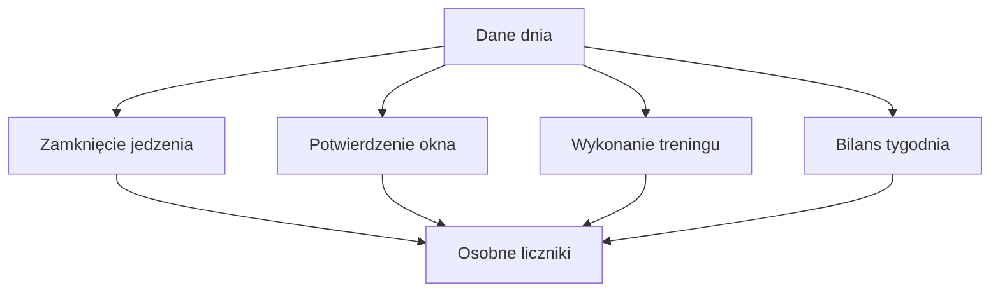

# Passa

## Co to jest

Passa pokazuje liczbę kolejnych zaliczonych dni lub tygodni. Są cztery liczniki: zamknięte dni jedzenia, okno 10–20, zgodność z planem treningowym i tygodniowy cel redukcji.

## Po co

Pomaga zobaczyć regularność i zaległe potwierdzenia. Przekroczenie celu kcal samo w sobie nie przerywa passy jedzenia.

## Skąd dane

Reguły Passy odczytują potwierdzenia jedzenia, Kalendarz, plan Trenera, aktywności i pomiary masy.

## Jak liczone

Dzień jedzenia zalicza się po terminowym zamknięciu. Okno zależy od potwierdzenia lub wykrytej godziny wpisu, z neutralnymi wyjątkami. Trening ocenia wykonanie planu, a redukcja jest tygodniowa: wymaga między innymi zamkniętych dni, ważeń i bilansu w wyznaczonym przedziale. Po każdych 7 dniach można zgromadzić jedno zamrożenie; limit wynosi dwa. Niezaliczony dzień zużywa zamrożenie, jeśli jest dostępne.

Przykład reguły: przy 7 kolejnych zaliczeniach licznik może uzyskać jedno zamrożenie. To wartość wynikająca z kodu, nie przykład konkretnej historii Michała.

### Przykład krok po kroku

1. Każdy licznik czyta inny warunek: zamknięcie dziennika, potwierdzenie okna, wykonanie planu lub tygodniowy bilans.
2. Dla dnia jedzenia ważne jest terminowe zamknięcie; przekroczenie celu kcal samo w sobie nie zrywa licznika.
3. Potwierdzenie okna można podać do południa następnego dnia; długi trening i wskazane wyjazdy dają dzień neutralny.
4. Po każdych 7 dniach może dojść jedno zamrożenie, maksymalnie dwa. Zamrożenie chroni licznik przed jednym niezaliczonym dniem.

Przykład z bazy za 14.10.2026 potwierdza 2604 kcal zapisane, ale nie mówi sam w sobie, czy dzień był zamknięty ani czy okno zostało dotrzymane.

## Gdzie to widać

Zakładka Passa oraz nagłówek wieczornej wiadomości dnia.

## Jak czytać

Dzień „neutralny” nie zwiększa i nie zrywa licznika. Nowe dni mają termin do południa następnego dnia. Kamienie milowe to 3, 7, 14, 30, 50, 100, 150, 200 i 365.

## Decyzje i historia

Zasady zależą od rodzaju licznika; nie należy traktować ich jako jednej wspólnej passy. Kod zawiera osobne obliczenia jedzenia, okna, treningu i redukcji.

## Ograniczenia i pułapki

Początek historii i terminy różnią się między licznikami. Passa redukcji wymaga danych tygodniowych, więc nie aktualizuje się jak licznik dzienny.

## Wpływa na

Widok regularności i krótkie powiadomienia o kamieniach milowych.

## Zależy od

Zamknięcia dni, potwierdzeń okna, planu Trenera oraz wpisanych ważeń i bilansu.

## Powiązane hasła

- [Dziennik jedzenia](dziennik.md)
- [Okno 10–20](okno-10-20.md)
- [Kalendarz Trenera](../trener/kalendarz.md)

## Jak czytać praktycznie

Sprawdź nazwę licznika przed interpretacją płomienia w nagłówku. Licznik zamkniętych dni dotyczy uzupełnienia dziennika, a licznik okna dotyczy godzin jedzenia. To różne warunki. Możesz mieć dzień zapisany i zamknięty, ale niepotwierdzone okno.

Zrzut ekranu pokazuje kilka osobnych liczników u góry. Stan „zamknięty” na kaflu dnia jest innym sygnałem niż liczby passy. Jeżeli licznik się zatrzyma, sprawdź najpierw brakujące potwierdzenie i termin, a dopiero potem samą wartość kcal. Przekroczenie celu kcal nie zrywa passy jedzenia.

## Zrodla

- `/opt/qbot/app/qbot_food_streaks.py` — `streaks`, `_run`, `train_results`, `reduce_streak`, `MILESTONES`.
- `/opt/qbot/app/qbot_food_api.py` — endpoint `/streaks`.
- `/opt/qbot/app/docs/BROKUL.md` — „Pasy, okno żywieniowe”.
