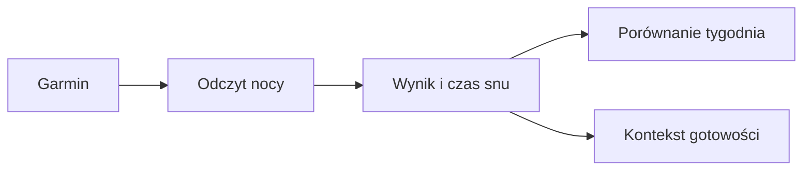

# Sen

## Co to jest

Karta snu pokazuje pomiary nocne z Garmina, między innymi czas i ocenę snu, nocną zmienność rytmu serca (HRV; [wyjaśnienie](../slowniczek.md#hrv)) oraz tętno spoczynkowe.

## Po co

Pozwala porównać noc z osobistą historią i dostarcza kontekstu do gotowości oraz analizy tygodnia jedzenia.

## Skąd dane

Dane snu pochodzą z synchronizacji Garmina. Analiza tygodnia jedzenia wykorzystuje ocenę snu.

## Jak liczone

W analizie tygodnia „dobra noc” oznacza ocenę co najmniej 70, a „słaba noc” wynik poniżej 70. Te grupy służą do porównywania wzorców jedzenia, nie do oceny medycznej.

Widok snu i porównania tygodnia korzystają z zsynchronizowanych zapisów nocnych.

## Gdzie to widać

Na stronie Zdrowie, w karcie lub zakładce opisanej w tym haśle. Główne elementy działu i ich położenie pokazuje [przegląd Zdrowia](index.md).

## Jak czytać

Traktuj wynik jako podsumowanie zapisanych danych i reguł QBota. Sprawdź datę, kompletność wpisów i stan potwierdzenia, zanim porównasz go z innym dniem.

## Decyzje i historia

Bieżące działanie opisuje kod; starszy opis projektu może nie obejmować późniejszych zmian. W razie różnicy pierwszeństwo ma działający kod.

## Powiązane hasła

- [Serce](serce.md)
- [Gotowość](../forma/gotowosc.md)

## Jak czytać praktycznie

Jeśli rano wynik snu jest niższy niż zwykle, sprawdź kilka kolejnych nocy oraz pozostałe dane regeneracji. Pojedyncza ocena urządzenia nie przesądza o przyczynie gorszego samopoczucia. W analizie tygodnia próg 70 dzieli tylko dwie grupy porównawcze; nie jest uniwersalną granicą zdrowego snu.

Przykłady z 16–18.10.2026 to 72, 89 i 72. Wszystkie trzy przekraczają próg 70 używany przez analizę żywienia. Trzy noce nie wystarczą do wniosku o długim trendzie ani wpływie konkretnego suplementu. Karta suplementów wymaga co najmniej siedmiu potwierdzonych nocy w każdej porównywanej grupie.

## Granice porównania

Wartości ocen snu pochodzą od urządzenia i mogą się zmieniać po synchronizacji. QBot używa ich do własnych porównań, ale nie interpretuje ich jako diagnozy. Gdy brakuje nocy, wynik tygodniowy ma mniejszą podstawę porównania. Porównuj podobne okresy i uwzględniaj samopoczucie, a nie tylko kolor albo pojedynczą liczbę.

## Zrodla

- `/opt/qbot/app/qbot_food_api.py` — `week_analysis`, odczyt `sleep_score`.
- `/opt/qbot/app/docs/SERCE.md` — wykorzystanie snu w analizie serca.
- `qbot_v2.qbot_sleep_daily`.
