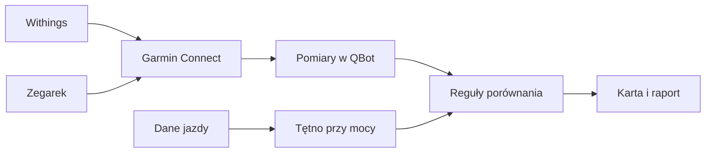

# Serce

## Co to jest

Karta Serce zbiera pomiary ciśnienia i tętna, elektrokardiogram (EKG; [wyjaśnienie](../slowniczek.md#zdrowie-i-jedzenie)) oraz zmienność rytmu serca (HRV; [wyjaśnienie](../slowniczek.md#hrv)) i wybrane dane o śnie i aktywności. Wyniki są sygnałami do obserwacji, nie diagnozą.

## Układ zakładki (od 20.10.2026)

Dwa poziomy. **Na górze** wniosek („co mówią dane”: tekst AI + punkty do obserwacji, pozycje w normie zwinięte) i 7 kafli: tętno spoczynkowe, HRV, ciśnienie, oddech w nocy ([SpO2 nocne](spo2.md)), serce w wysiłku (tętno przy mocy + HRR60), EKG, [bateria](bateria.md). **Pod nimi** jeden wspólny wykres: 7 paneli na tej samej osi dni z jednym kursorem i powiększaniem, z liniami dni z alkoholem. **Na dole** szczegóły tylko jednego, wybranego kafla: tabela ciśnienia z raportem PDF i instrukcją „Kiedy i jak mierzyć”, lista EKG z przebiegiem i komentarzem AI, noc minuta po minucie. Kliknięcie dnia na wykresie otwiera tę noc. Talia, waga i BMI są w zakładce Ciało.

## Po co

Ułatwia przegląd własnych pomiarów i przygotowanie raportu do rozmowy z lekarzem.

## Skąd dane

Ciśnienie pochodzi z Withings przez Garmin Connect. EKG i część pomiarów pochodzą z Garmina. Tętno przy mocy jest liczone z sekundowych próbek aktywności; tętno spoczynkowe i dane wellness pochodzą z Garmin Connect.

## Jak liczone

Kod modułu Serca porównuje średnią ostatnich 28 dni z medianą osobistej normy z dni 29–365. W dokumentacji opisano progi sygnałów: tętno spoczynkowe +3 uderzenia/min jako uwaga i +5 uderzeń/min jako wyraźniejszy sygnał; tętno przy mocy +5/+8 uderzeń/min. Ciśnienie ocenia średnią serii, a zapis EKG analizuje osobny moduł.

Przykład historyczny zweryfikowany w dokumentacji: porównanie EKG z 13.10.2026 pokazało zbliżone tętno QBota i Garmina, ale różne wyniki pomiaru zmienności rytmu serca. To przypomnienie, że metody mogą dawać inne wyniki.

### Przykład krok po kroku

1. W przypadku ciśnienia kod zbiera serię z maksymalnie 8 dni wstecz od ostatniego pomiaru.
2. Jeśli seria obejmuje co najmniej 3 dni, odrzuca pierwszy dzień, a średnią wylicza z pozostałych odczytów.
3. Średnia poniżej 130/80 ma etykietę „prawidłowe”; 130–134 lub 80–84 to „wysokie prawidłowe”; od 135 lub 85 — „podwyższone”; od 180 lub 110 — pilny sygnał do kontaktu z lekarzem.
4. Pełny protokół zbiera 7 dni, z co najmniej 6 pomiarami rano i 6 wieczorem.
5. Odczyt karty z 18.10.2026 pokazał średnią serii ciśnienia 125/81. W tym samym odczycie najnowsze EKG z 17.10 miało opis rytmu zatokowego, średnie tętno 55/min i HRV 43 ms.

To przykładowe wyniki z karty, nie diagnoza. Dostarczony zrzut pokazuje tylko górny pasek z zakładką Serce, a nie jej zawartość.

## Gdzie to widać

Zdrowie → Serce, wykresy, szczegóły EKG i raport w pliku PDF (dokumencie do wydruku) dla lekarza. Albert ma funkcję odczytu danych serca.

## Jak czytać

Oceny są sygnałami opartymi na regułach QBota. Nie rozpoznają choroby. Raport zbiera fakty do omówienia z lekarzem.

## Decyzje i historia

Decyzja z 12.10.2026: ciśnienie z Withings przechodzi przez Garmina; ocena EKG opiera się na powtarzalnych regułach, a sztuczna inteligencja (AI; [wyjaśnienie](../slowniczek.md#ai-sztuczna-inteligencja)) może jedynie opisać kontekst na podstawie faktów.

## Ograniczenia i pułapki

Pomiary starsze niż 90 dni są oznaczane jako stare. Różne urządzenia i metody mogą różnić się w wyliczeniu HRV. Pojedynczy odczyt nie powinien być interpretowany jako diagnoza.

## Wpływa na

Karty zdrowotne, kontekst w raporcie lekarza i niektóre sygnały regeneracji.

## Zależy od

Synchronizacji Garmina/Withings, jakości pomiarów i dostępnej historii.

## Powiązane hasła

- [Suplementy i leki](suplementy.md)
- [Sen](../forma/sen.md)
- [Gotowość](../forma/gotowosc.md)
- [Połączenia](../polaczenia/index.md)

## Zrodla

- `/opt/qbot/app/docs/SERCE.md` — źródła, reguły, ograniczenia i decyzje.
- `/opt/qbot/app/qbot_heart.py` — `nexus` i oceny serca.
- `/opt/qbot/app/qbot3/connectors/import_garmin_heart.py` — import ciśnienia i EKG.
- `/opt/qbot/app/qbot_food_api.py` — endpointy zdrowia, w tym `/heart_plus`.
- `/opt/qbot/app/docs/DECISIONS.md` — decyzje 12–13.10.2026.
