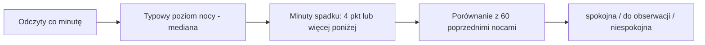

# SpO2 nocne

## Co to jest

Zegarek (Fenix 8) w czasie snu mierzy saturację krwi tlenem (SpO2) co minutę — ok. 350 odczytów na noc. QBot zamienia je w jedną ocenę nocy: **spokojna**, **do obserwacji** albo **niespokojna**.

## Po co

Sama średnia z nocy (np. 96%) prawie się nie zmienia i niewiele mówi. Ważniejsze jest, ile razy i jak długo saturacja spadała. Częste spadki mogą świadczyć o gorszym oddychaniu w nocy (pozycja, alkohol, przeziębienie, wysokość) i warto widzieć, czy narastają.

## Skąd dane

Pełna odpowiedź Garmina o śnie jest zapisywana codziennie w tabeli `garmin_daily_raw` (lista `wellnessEpochSPO2DataDTOList`). Odczyty minutowe są od **01.06.2026** — starszych Garmin już nie oddaje (trzyma je ok. 4,5 miesiąca). Wcześniejsze noce mają tylko średnie (`spo2_daily`). Data nocy = dzień pobudki.

## Jak liczone

1. Dla każdej nocy liczona jest jej mediana SpO2 — własny poziom odniesienia tej nocy.
2. **Minuty spadku** = minuty, w których SpO2 ≤ mediana − 4 pkt. Kolejne minuty spadku z przerwą do 3 min to jeden **spadek**.
3. Liczba minut spadku jest porównywana z 60 poprzednimi nocami (potrzeba min. 20): do 75. percentyla — spokojna, do 90. — do obserwacji, powyżej — niespokojna.
4. „Ostatnie noce” = 7 ostatnich ocenionych nocy vs mediana 30 nocy przed nimi.
5. „Co idzie w parze”: alkohol dzień wcześniej i mocna jazda dzień wcześniej (TSS ≥ 100) vs minuty spadku, a niespokojna noc vs HRV i ocena snu rano. Wniosek pokazuje się tylko przy wyraźnej różnicy i min. 8 nocach w grupie.

### Przykład krok po kroku

1. Noc 19/20.10.2026: 343 odczyty, mediana 97%, więc próg spadku to 93%.
2. 41 minut było na poziomie 93% lub niżej, w 10 spadkach; najniżej 89%.
3. 60 poprzednich nocy: 75. percentyl = 26,5 min, 90. percentyl = 43,2 min. 41 mieści się między nimi → **do obserwacji**.

## Gdzie to widać

Na razie na stronie testowej `zdrowie-spo2-test.html` (kafel wniosku, wykres nocy, przebieg nocy minuta po minucie). Docelowo kafel w Zdrowie › Serce — po akceptacji Michała.

## Ograniczenia

To nie jest badanie medyczne. Pojedyncze spadki są normalne (ruch, ucisk zegarka, pozycja). Pomiar nadgarstkowy bywa zaniżony.
