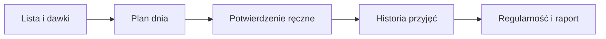

# Suplementy i leki

## Co to jest

To lista suplementów i leków, ich dawek oraz dziennych potwierdzeń przyjęcia. QBot nie zaznacza przyjęcia automatycznie.

## Po co

Ułatwia prowadzenie historii i przygotowuje listę leków oraz suplementów do raportu dla lekarza.

## Skąd dane

Dane są przechowywane w liście suplementów, wersjach dawek i potwierdzeniach. Zmiana dawki tworzy nową wersję od wybranej daty.

## Jak liczone

Rano QBot może pokazać przycisk potwierdzający wszystkie zaplanowane pozycje z poprzedniego dnia. Przycisk nie nadpisuje ręcznie oznaczonych wyjątków. Strona pokazuje regularność z 35 dni i kalendarz, w którym można oznaczyć „wzięte” lub „pominięte”. Porównanie wpływu na noc wymaga co najmniej 7 potwierdzonych nocy w każdej porównywanej grupie.

Karta pokazuje regularność z 35 dni. Brak wpisu pozostaje niepotwierdzony, a nie automatycznie „pominięty”.

### Przykład krok po kroku

1. Odczyt z 18.10.2026 pokazuje trzy aktywne pozycje: magnez, witaminę D3 i melatoninę.
2. W sześciu dniach od 12.10 do 17.10 zapisano po trzy potwierdzenia dziennie.
3. Karta regularności zwraca dla każdej pozycji 9 planowanych i 9 potwierdzonych przyjęć w bieżącym oknie; w tej próbce wynik to 100%.
4. Porównanie wpływu na noc wymaga co najmniej siedmiu nocy w obu grupach. Odczyt pokazuje 9 nocy „wzięte” i 0 „pominięte”, więc nie ma grupy porównawczej.

## Gdzie to widać

Zdrowie → Suplementy, poranna wiadomość Telegrama oraz raport PDF dla lekarza w części Serce.

## Jak czytać

Brak potwierdzenia oznacza „niepotwierdzone”, a nie pewność, że dawka została pominięta. Karta wpływu na noc pokazuje porównanie danych, nie dowód przyczynowy.

## Decyzje i historia

Decyzja z 13.10.2026: potwierdzenie rano za dzień poprzedni, jednym przyciskiem „Wszystkie”; wyjątki poprawiane na stronie; bez osobnej passy suplementów.

## Ograniczenia i pułapki

Tryb „totalny luz” nie wysyła porannej wiadomości. Przy codziennym potwierdzaniu „Wszystkie” może zabraknąć dni oznaczonych jako pominięte do porównania nocy.

## Wpływa na

Listę leków i suplementów w raporcie dla lekarza oraz statystyki regularności.

## Zależy od

Wpisanej listy, wersji dawki i ręcznego potwierdzenia.

## Powiązane hasła

- [Serce](serce.md)
- [System](../system/index.md)

## Jak czytać praktycznie

Jeśli rano jest przycisk potwierdzenia, dotyczy on poprzedniego dnia. Zanim go użyjesz, sprawdź, czy nie było wyjątku, który wymaga osobnego oznaczenia. Potwierdzenie zbiorcze nie powinno nadpisywać ręcznych zapisów. W dzień bez wiadomości możesz sprawdzić i uzupełnić kalendarz na stronie.

W odczycie bazy są po trzy logi dziennie od 13.10 do 17.10.2026. To potwierdza historię zapisów, ale nie mówi, co dokładnie przyjęto bez sprawdzenia listy i dawki obowiązującej danego dnia. Raport dla lekarza porządkuje listę; przed rozmową upewnij się, że dawki i przyjmowane pozycje są aktualne.

## Zrodla

- `/opt/qbot/app/docs/SUPLEMENTY.md` — decyzje, dane i przepływ.
- `/opt/qbot/app/docs/DECISIONS.md` — decyzja 13.10.2026.
- `qbot_v2.supplement`, `qbot_v2.supplement_dose`, `qbot_v2.supplement_log`.
