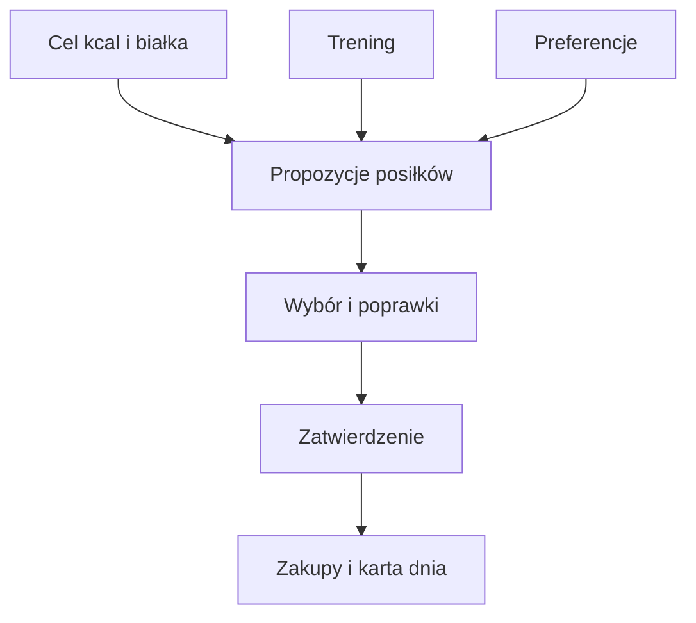

# Plan weekendu

## Co to jest

Plan weekendu podaje propozycje jedzenia na sobotę i niedzielę, gdy nie ma cateringu Brokuła. Uwzględnia cele kcal i białka, zaplanowane treningi oraz listę zakupów.

## Po co

Pomaga zaplanować posiłki i zakupy z wyprzedzeniem, w tym jedzenie na rower.

## Skąd dane

Dane dnia pochodzą z planu QBota. Plan, wybory i lista zakupów są zapisane oddzielnie od profilu preferencji.

## Jak liczone

QBot przygotowuje liczby celu kcal, białka i paliwa na rower. Sztuczna inteligencja (AI; [wyjaśnienie](../slowniczek.md#ai-sztuczna-inteligencja)) generuje propozycje potraw na ich podstawie, a Michał może wybierać, zmieniać, zatwierdzać i oznaczać zakupy. AI nie zmienia ustalonych liczb celu i paliwa.

Plan weekendu opisano w dokumentacji Brokuła. Dostępne są preferencje, oceny posiłków i poprawki po komentarzach.

## Ograniczenia i pułapki

Plan wymaga wygenerowania i zatwierdzenia. Szacowane składniki oraz czasy przygotowania nie zastępują etykiet produktów ani własnej oceny.

## Gdzie to widać

Na stronie Zdrowie, w karcie lub zakładce opisanej w tym haśle. Główne elementy działu i ich położenie pokazuje [przegląd Zdrowia](index.md).

## Jak czytać

Traktuj wynik jako podsumowanie zapisanych danych i reguł QBota. Sprawdź datę, kompletność wpisów i stan potwierdzenia, zanim porównasz go z innym dniem.

## Decyzje i historia

Bieżące działanie opisuje kod; starszy opis projektu może nie obejmować późniejszych zmian. W razie różnicy pierwszeństwo ma działający kod.

## Wpływa na

Plan zakupów, wybory posiłków i zapis zjedzonych dań w dzienniku.

## Zależy od

Planu Trenera, celu dnia, preferencji, zatwierdzenia Michała i generowania propozycji.

## Powiązane hasła

- [Cel kcal](cel-kcal.md)
- [Białko](bialko.md)
- [Paliwo na rower](paliwo-rower.md)
- [Dziennik jedzenia](dziennik.md)

## Jak czytać praktycznie

Jeśli w piątek widzisz plan, sprawdź najpierw, czy to propozycja czy plan zatwierdzony. Zmień potrawę lub porcję, jeśli nie odpowiada Twoim preferencjom, a następnie zatwierdź wybór. Lista zakupów ma sens dopiero po sprawdzeniu składników i liczby porcji.

Suma widoczna w karcie planu nie oznacza automatycznie kalorii już zjedzonych. Po posiłku oznacz go jako zjedzony, aby trafił do właściwego dnia. Własne potrawy mogą mieć wartości szacowane. Nie używaj ich jako danych etykietowych przy precyzyjnym porównaniu makr.

## Zrodla

- `/opt/qbot/app/qbot_food_weekend.py` — budowa, profil, wybory i zatwierdzanie planu.
- `/opt/qbot/app/qbot_food_plan.py` — `weekend_text`, `day_plan`.
- `/opt/qbot/app/docs/BROKUL.md` — „Weekend bez diety”.
