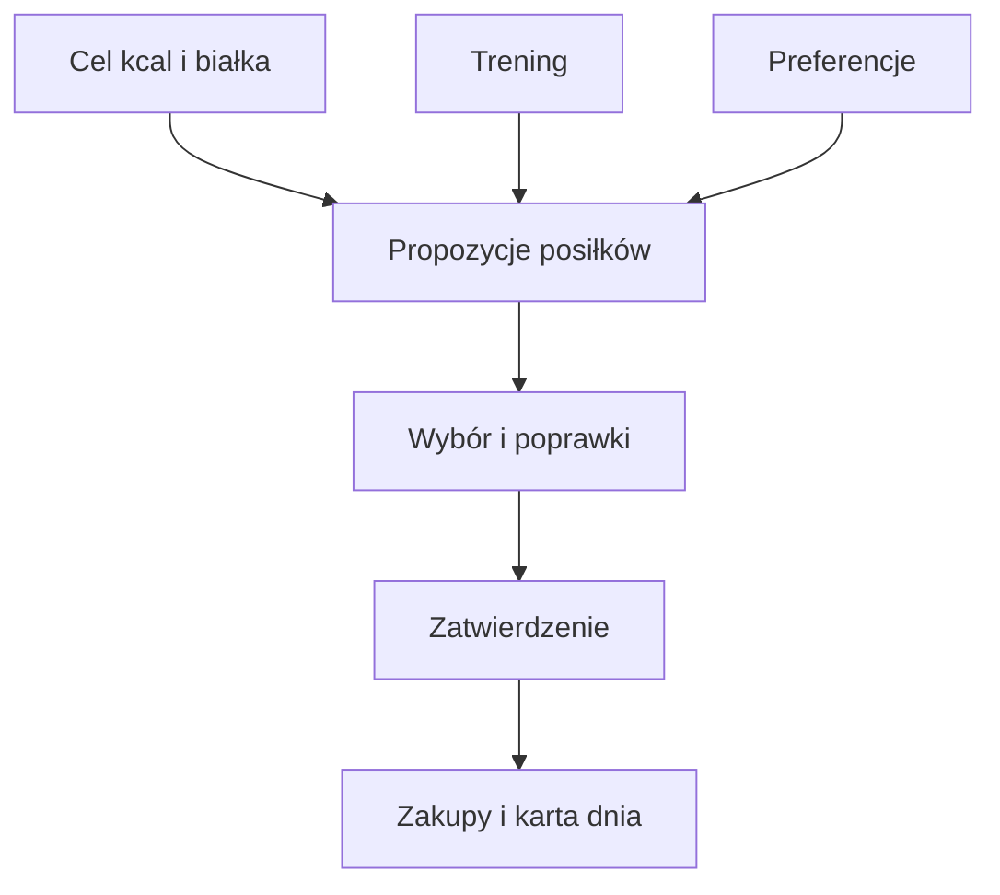

# Plan weekendu

## Co to jest

Plan weekendu podaje propozycje jedzenia na sobotę i niedzielę, gdy nie ma cateringu Brokuła. Uwzględnia cele kcal (kilokalorii; [wyjaśnienie](../slowniczek.md#zdrowie-i-jedzenie)), białka 160 g, paliwo na rower oraz listę zakupów.

## Po co

Pomaga zaplanować posiłki i zakupy z wyprzedzeniem, w tym jedzenie na rower.

## Skąd dane

Dane dnia pochodzą z planu QBota. Plan, wybory i lista zakupów są zapisane oddzielnie od profilu preferencji.

## Jak liczone

QBot przygotowuje liczby celu kcal, białka i paliwa na rower. Cel białka to 160 g również w planie weekendowym. Sztuczna inteligencja (AI; [wyjaśnienie](../slowniczek.md#ai-sztuczna-inteligencja)) generuje propozycje potraw na ich podstawie, a Michał może wybierać, zmieniać, zatwierdzać i oznaczać zakupy. AI nie zmienia ustalonych liczb celu i paliwa.

Plan weekendu opisano w dokumentacji Brokuła. Dostępne są preferencje, oceny posiłków i poprawki po komentarzach.

### Przykład krok po kroku

1. Plan na weekend 17–18.10.2026 został utworzony 15.10 o 19:10 i zatwierdzony o 19:21.
2. Zapis zawierał cztery wybrane pozycje na niedzielę. Jedna pozycja śniadaniowa miała 551 kcal w planie na dwie osoby.
3. W podsumowaniu strony widoczna suma planu weekendu wynosiła 2486 kcal. Ta liczba opisywała wybrane propozycje, a nie samodzielny wpis jedzenia.
4. Po zjedzeniu należy użyć „Zjadłem”. Dopiero status zjedzenia w karcie dnia przekazuje pozycję do bilansu.

Przykład paliwa na rower z 18.10.2026: zapis jazdy ma 146,9 min, więc plan jedzenia wykorzystuje ten czas i podaje 80 g. Kalendarz miał 163 min; byłby użyty tylko wtedy, gdy nie byłoby jeszcze zapisu jazdy. Regułę opisuje [Paliwo na rower](paliwo-rower.md).

## Ograniczenia i pułapki

Plan wymaga wygenerowania i zatwierdzenia. Szacowane składniki oraz czasy przygotowania nie zastępują etykiet produktów ani własnej oceny.

Paliwo dla roweru korzysta z czasu zarejestrowanej jazdy, jeśli jest już dostępna. Jeśli jej nie ma, używa planu z Kalendarza. Szczegóły i przykład liczb opisuje [Paliwo na rower](paliwo-rower.md).

## Gdzie to widać

Na stronie Zdrowie, w karcie lub zakładce opisanej w tym haśle. Główne elementy działu i ich położenie pokazuje [przegląd Zdrowia](index.md).

## Jak czytać

Traktuj wynik jako podsumowanie zapisanych danych i reguł QBota. Sprawdź datę, kompletność wpisów i stan potwierdzenia, zanim porównasz go z innym dniem.

## Decyzje i historia

Bieżące działanie opisuje kod; starszy opis projektu może nie obejmować późniejszych zmian. W razie różnicy pierwszeństwo ma działający kod.

Od 19.10.2026 cel białka w planie weekendowym wynosi 160 g, zgodnie z pozostałymi widokami.

## Wpływa na

Plan zakupów, wybory posiłków i zapis zjedzonych dań w dzienniku.

## Zależy od

Planu Trenera, celu dnia, preferencji, zatwierdzenia Michała i generowania propozycji.

## Powiązane hasła

- [Cel kcal](cel-kcal.md)
- [Białko](bialko.md)
- [Paliwo na rower](paliwo-rower.md)
- [Dziennik jedzenia](dziennik.md)

## Jak czytać praktycznie

Jeśli w piątek widzisz plan, sprawdź najpierw, czy to propozycja czy plan zatwierdzony. Zmień potrawę lub porcję, jeśli nie odpowiada Twoim preferencjom, a następnie zatwierdź wybór. Lista zakupów ma sens dopiero po sprawdzeniu składników i liczby porcji.

Suma widoczna w karcie planu nie oznacza automatycznie kalorii już zjedzonych. Zielony przycisk „Zjadłem” jest działaniem do użycia, nie znacznikiem potwierdzającym stan. Plan z piątku 16.10.2026 został zatwierdzony 15.10 o 19:21; późniejsza karta dnia pokazała jako zjedzone tylko śniadanie 551 kcal, a pozostałe propozycje jako pominięte. Potwierdzenie planu wyboru nie zastępuje potwierdzenia zjedzenia. Własne potrawy mogą mieć wartości szacowane.

## Zrodla

- `/opt/qbot/app/qbot_food_weekend.py` — budowa, profil, wybory i zatwierdzanie planu.
- `/opt/qbot/app/qbot_food_plan.py` — `weekend_text`, `day_plan`.
- `/opt/qbot/app/docs/BROKUL.md` — „Weekend bez diety”.
